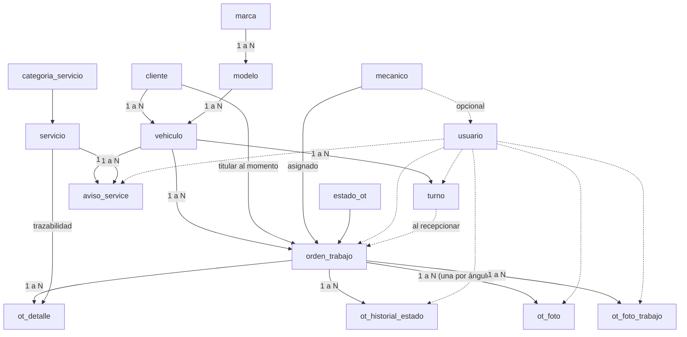
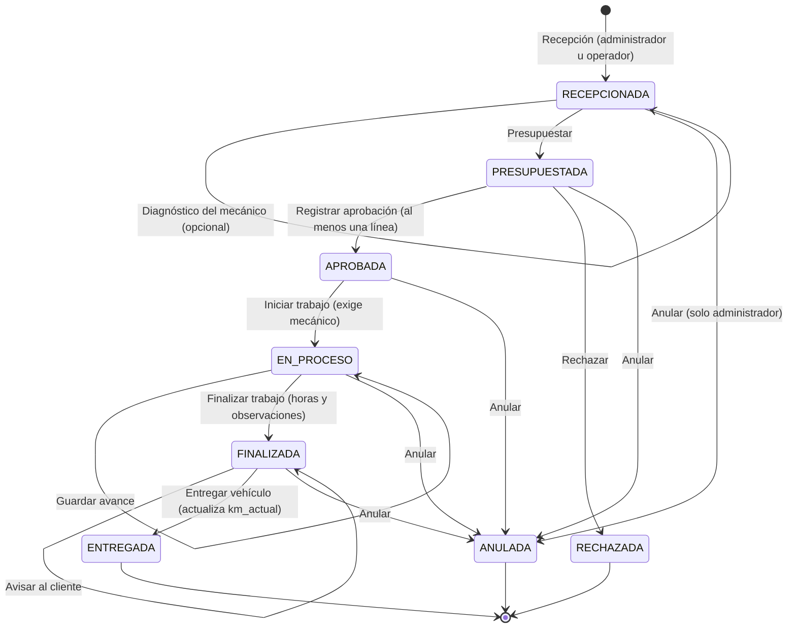

# Taller Mecánico — Documentación técnica

Este documento describe cómo está construido el sistema: arquitectura, modelo de datos, pantallas, flujo de la orden de trabajo, reportes, decisiones técnicas y límites conocidos. La instalación, los usuarios de prueba y el guion de demostración están en el [README](../README.md); la especificación funcional, en `taller-mecanico-especificacion.md`; el manual de usuario, con una captura de cada pantalla, en [manual-usuario.md](./manual-usuario.md).

---

## Qué es

Aplicación de escritorio Windows Forms (VB.NET, .NET 10) conectada a una base MariaDB, que administra los servicios de un taller mecánico. Es un trabajo práctico universitario que sigue el estilo de programación orientada a eventos de la cátedra. El alcance acordado con la cátedra el 27/08 cubre solo la actividad de **servicios**: queda fuera la facturación, los pagos, la venta de insumos y el control de stock (`taller-mecanico-especificacion.md`, sección 2).

El dominio (cliente, vehículo, turno, orden de trabajo, presupuesto) genera de forma natural las relaciones que justifican un modelo relacional, y la consigna exige una aplicación de escritorio en dos capas con salida impresa.

Repositorio: https://github.com/MedinaLucas1996/taller-mecanico (público).

---

## Arquitectura

### Cómo arranca y cómo se navega

- El formulario de inicio es `FrmLogin` (`MainForm` en `My Project/Application.myapp`). Muestra una imagen de fondo y reproduce música en bucle, ambas desde `WinFormsApp1/Recursos/`; si falta alguna, el login sigue en silencio. El botón INGRESAR (también con Enter) valida que usuario y contraseña no estén vacíos, busca el usuario activo en `usuario` por `nombre_usuario` y verifica la contraseña con `Seguridad.VerificarClave`. Si el usuario no existe, está inactivo o la clave es incorrecta, muestra el mismo mensaje ("Usuario o contraseña incorrectos."), limpia la contraseña y permanece en el login. Tras `MAXIMO_INTENTOS` (5) fallos seguidos, el botón se deshabilita `SEGUNDOS_BLOQUEO` (30) con una cuenta regresiva; el contador vive en memoria y un ingreso correcto lo reinicia. Si es correcto, completa el `Module Sesion` (`IdUsuario`, `NombreUsuario`, `NombreCompleto`, `Rol`, `IdMecanico`, este último en 0 si el usuario no es mecánico), abre `FrmPrincipal`, detiene la música y oculta el login.
- `Module Seguridad` implementa el hash de contraseñas con PBKDF2 + SHA256 (100000 iteraciones, hash de 32 bytes, salt aleatorio de 16 bytes, ambos en Base64): `GenerarSalt`, `HashearClave` y `VerificarClave` (comparación en tiempo constante con `CryptographicOperations.FixedTimeEquals`; devuelve `False` si el hash o el salt guardados no son Base64 válido, por ejemplo un hash BCrypt anterior). `Module Sesion` guarda los datos del usuario que inició sesión y tiene `CerrarSesion`.
- `FrmPrincipal` está armado en el diseñador (`FrmPrincipal.Designer.vb`), con manejadores `Handles`: menú lateral, barra superior y un panel de contenido. Las pantallas se abren dentro del panel con `AbrirFormulario` (`TopLevel = False`, `Dock = Fill`); no es un contenedor MDI. Antes de abrir una, `CerrarPantallaActual` llama a `Close()` sobre la pantalla que estaba abierta: eso dispara su `FormClosing`, y si la pantalla no lo cancela queda liberada y sale del panel. Si lo cancela, la pantalla nueva no se abre. Cancelan el cierre cuando hay cambios o una carga a medias y el usuario no los descarta: Categorías, Clientes, Mecánicos, Recepción, Servicios, Turnos, Usuarios y Vehículos en el panel, y Gestión de la orden como ventana modal. "Cerrar sesión" y el cierre de la ventana principal (`FrmPrincipal_FormClosing`) usan la misma rutina, y ninguno pregunta dos veces. Al cerrar `FrmPrincipal` se llama a `Application.Exit()`, salvo cuando se cierra por "Cerrar sesión".
- La barra superior muestra el nombre completo y el rol del usuario de `Sesion`, y a su derecha "Cambiar contraseña" (abre `FrmCambiarClave`: pide la actual, la nueva de al menos `LARGO_MINIMO_CLAVE` caracteres y su repetición, y guarda salt y hash nuevos) y "Cerrar sesión" (pide confirmación, limpia `Sesion` con `CerrarSesion()`, llama a `FrmLogin.PrepararNuevoIngreso()`, que vacía usuario y contraseña, vuelve a mostrar el login y reinicia la música, y cierra `FrmPrincipal`). Al ingresar otro usuario se crea un `FrmPrincipal` nuevo, por lo que el menú se arma según el rol de ese usuario.
- El menú se filtra por rol. Los botones y los tres títulos de sección tienen `Visible = False` en el diseñador, y `FrmPrincipal_Load` muestra los que corresponden con un bloque `If Sesion.Rol = "..." Then` por rol (ver [Menú por rol](#menú-por-rol)). Un rol desconocido no ve ninguna opción. El administrador y el operador arrancan en `FrmInicio`; el mecánico conserva el texto de bienvenida del panel.
- Menú lateral (`panelMenu`, acoplado a la izquierda), con tres paneles declarados en el diseñador:
  - `panelLogo` (arriba): el botón `btnMenu`, que contrae y expande el menú, y el nombre del sistema.
  - `panelMenuArriba`: Operaciones (Inicio, Mis órdenes, Turnos, Recepción, Órdenes de trabajo, Historial, Services por vencer) y Reportes (Tableros), cada título sobre sus botones.
  - `panelMenuAbajo` (acoplado al borde inferior): Datos maestros (Clientes, Vehículos, Marcas y modelos, Servicios, Categorías, Mecánicos, Usuarios). Sus botones se acoplan hacia abajo, de modo que las opciones ocultas por rol no dejan huecos.
  - Iconos: `LeerIcono` lee en `FrmPrincipal_Load` cada PNG de `Recursos\iconos` junto al ejecutable (el proyecto los copia a la carpeta de salida). Si un archivo falta o no se puede leer, el botón queda sin icono. Los iconos provienen de Lucide (licencia ISC, texto en `Recursos/iconos/LICENCIA-lucide.txt`).
  - Contraer y expandir: `AplicarMenu` cambia el ancho del menú entre 230 y 56. Contraído oculta los títulos de sección y el nombre del sistema, deja en cada botón solo el icono centrado y le asigna su nombre como tooltip (`tipMenu`); un botón sin icono muestra su inicial. El nombre de cada opción se guarda en el `Tag` del botón. El panel de contenido está acoplado con `Fill` y ocupa el ancho que el menú libera. El menú arranca siempre expandido. La opción de la pantalla abierta queda resaltada y el título de la ventana muestra el nombre de esa pantalla.
  - Títulos de sección: un título se muestra solo con el menú expandido y cuando el rol tiene al menos una opción en esa sección.
- Cada pantalla abre su propia conexión con `Using cn As New MySqlConnection(CADENA)` dentro del evento correspondiente, ejecuta una consulta parametrizada y vuelca el resultado a la grilla con `DataTable.Load`. `CADENA` es `Public ReadOnly CADENA As String = LeerCadena()` en `Module ConexionBD`: se lee una vez al iniciar desde `conexion.txt` junto al ejecutable, o se usa `CADENA_POR_DEFECTO` (`localhost`, `root`, sin contraseña) si el archivo no existe. En un puesto real `conexion.txt` usa el usuario `taller_app` que crea `database/14_usuario_app.sql`. Si el archivo existe pero no se puede leer o está vacío, el login no deja entrar y el motivo queda en el registro de errores.
- Errores: `Module Errores` (`Errores.vb`) centraliza el aviso al usuario y el registro. `MostrarError(mensaje, ex)` muestra el mensaje y escribe fecha, usuario, contexto y detalle en `%LocalAppData%\TallerMecanico\errores.log`; traduce una falla de conexión a "No se pudo conectar con la base de datos." y un rechazo de credenciales a un pedido de revisar `conexion.txt`. `Deshacer(transaccion)` hace el `Rollback` y registra si ese `Rollback` también falla. `MyApplication.UnhandledException` (`ApplicationEvents.vb`) registra los errores no atrapados, pregunta si se sigue trabajando y cierra la aplicación si el error se repite tres veces seguidas en pocos segundos.

### Diagrama

```mermaid
graph TD
    subgraph Proyecto["WinFormsApp1.vbproj (WinExe, net10.0-windows): 22 formularios y 9 módulos"]
        subgraph Acceso["Acceso"]
            Login["FrmLogin"]
            CambiarClave["FrmCambiarClave"]
            Principal["FrmPrincipal<br/>(menú lateral y panel de contenido)"]
        end
        subgraph Operaciones["Operaciones"]
            Inicio["FrmInicio"]
            Turnos["FrmTurnos"]
            Recepcion["FrmRecepcion"]
            AltaRapida["FrmAltaRapida<br/>(modal)"]
            Ordenes["FrmOrdenes"]
            Gestion["FrmOrdenGestion<br/>(modal)"]
            Anular["FrmAnularOrden<br/>(modal)"]
            Foto["FrmFoto<br/>(modal)"]
            MisOrdenes["FrmMisOrdenes"]
            Historial["FrmHistorial"]
            Avisos["FrmServicesPorVencer"]
        end
        subgraph Maestros["Datos maestros"]
            Clientes["FrmClientes"]
            Vehiculos["FrmVehiculos"]
            Marcas["FrmMarcasModelos"]
            Servicios["FrmServicios"]
            Categorias["FrmCategorias"]
            Mecanicos["FrmMecanicos"]
            Usuarios["FrmUsuarios"]
        end
        subgraph Reportes["Reportes"]
            Tableros["FrmTableros<br/>(ScottPlot)"]
        end
        subgraph Modulos["Módulos compartidos"]
            ConexionBD["ConexionBD"]
            Seguridad["Seguridad"]
            Sesion["Sesion"]
            Errores["Errores"]
            Fotos["Fotos"]
            Impresion["Impresion"]
            Exportar["Exportar"]
            Grillas["Grillas"]
            Recordatorios["Recordatorios"]
            TurnosModulo["Turnos"]
        end
        AppEvents["ApplicationEvents.vb<br/>(MyApplication: errores no atrapados)"]
        Recursos["Recursos/<br/>(fondo, música e iconos)"]
    end

    subgraph Datos["Base de datos"]
        DB[("MariaDB: taller_mecanico<br/>16 tablas")]
        Scripts["database/<br/>scripts 01 a 12"]
    end

    Login --> Principal
    Login --> Seguridad
    Login --> Sesion
    Login -.-> Recursos
    Principal --> CambiarClave
    Principal -.-> Sesion
    Principal -->|"ADMINISTRADOR y OPERADOR"| Inicio
    Principal -->|"ADMINISTRADOR y OPERADOR"| Turnos
    Principal -->|"ADMINISTRADOR y OPERADOR"| Recepcion
    Principal -->|"ADMINISTRADOR y OPERADOR"| Ordenes
    Principal -->|"ADMINISTRADOR y OPERADOR"| Avisos
    Principal -->|"MECANICO"| MisOrdenes
    Principal -->|"los tres roles"| Historial
    Principal -->|"ADMINISTRADOR y OPERADOR"| Clientes
    Principal -->|"ADMINISTRADOR y OPERADOR"| Vehiculos
    Principal -->|"ADMINISTRADOR y OPERADOR"| Marcas
    Principal -->|"ADMINISTRADOR"| Servicios
    Principal -->|"ADMINISTRADOR"| Categorias
    Principal -->|"ADMINISTRADOR"| Mecanicos
    Principal -->|"ADMINISTRADOR"| Usuarios
    Principal -->|"ADMINISTRADOR"| Tableros
    Recepcion --> AltaRapida
    Turnos --> AltaRapida
    Ordenes --> Gestion
    MisOrdenes --> Gestion
    Gestion --> Anular
    Ordenes --> Foto
    Gestion --> Foto
    MisOrdenes --> Foto
    Inicio -.->|"abre"| Ordenes
    Inicio -.->|"abre"| Turnos
    Inicio -.->|"abre"| Avisos
    Avisos -.->|"Dar turno"| Turnos
    Inicio --> Recordatorios
    Avisos --> Recordatorios
    Turnos --> TurnosModulo
    Recepcion --> Fotos
    Ordenes --> Fotos
    Gestion --> Fotos
    Gestion --> Impresion
    Clientes --> Impresion
    Historial --> Impresion
    Tableros --> Impresion
    Ordenes --> Exportar
    Historial --> Exportar
    MisOrdenes --> Exportar
    Avisos --> Exportar
    Usuarios --> Seguridad
    CambiarClave --> Seguridad
    Operaciones --> ConexionBD
    Operaciones --> Grillas
    Maestros --> ConexionBD
    Maestros --> Grillas
    Reportes --> ConexionBD
    Reportes --> Grillas
    Operaciones -.-> Errores
    Maestros -.-> Errores
    AppEvents -.-> Errores
    ConexionBD -->|"MySqlConnector 2.6.2"| DB
    Scripts -.->|"crean y cargan"| DB
```



Los 22 formularios son los `Frm*.vb` de `WinFormsApp1/`; los 10 módulos son `ConexionBD`, `Errores`, `Exportar`, `Fotos`, `Grillas`, `Impresion`, `Recordatorios`, `Seguridad`, `Sesion` y `Turnos`. `ApplicationEvents.vb` es la clase parcial `MyApplication` del marco de aplicación de VB.NET, no un módulo.

### Stack técnico

| Capa | Tecnología |
|---|---|
| Lenguaje | VB.NET |
| Plataforma | .NET 10 (`net10.0-windows`), Windows Forms, `OutputType` WinExe |
| Patrones | Programación orientada a eventos con SQL dentro de los formularios; un único proyecto; módulos (`Module`) para el código compartido; sin DAO ni capas (ver [Decisiones técnicas](#decisiones-técnicas)) |
| Infraestructura | Cliente de escritorio de dos capas contra MariaDB (desarrollado con 12.2; el DDL indica 10.6 o superior), driver MySqlConnector 2.6.2 |
| Gráficos | ScottPlot.WinForms 5.1.59 (la misma versión que el ejemplo de clase), solo en `FrmTableros` |
| Reportes | `PrintDocument` + `PrintPreviewDialog` del diseñador, hojas dibujadas a mano en `PrintPage` con `Module Impresion` |

### Módulos compartidos

| Módulo | Qué contiene |
|---|---|
| `ConexionBD` | `CADENA` (leída de `conexion.txt` o por defecto), `ARCHIVO_CONEXION`, `LeerCadena`. |
| `Seguridad` | `GenerarSalt`, `HashearClave`, `VerificarClave` (PBKDF2 + SHA256). |
| `Sesion` | Usuario que inició sesión (`IdUsuario`, `NombreUsuario`, `NombreCompleto`, `Rol`, `IdMecanico`) y `CerrarSesion`. |
| `Errores` | `MostrarError`, `Deshacer`, escritura de `errores.log`. |
| `Fotos` | `CargarImagenReducida`, `ImagenABytes`, `LeerFotoComoJpeg`, `Miniatura`, `LeerIcono`: el mismo proceso de imagen para la recepción, el tablero, la gestión y Mis órdenes. |
| `Impresion` | Rutinas de dibujo de los reportes, sin SQL (ver [Reportes](#reportes)). |
| `Exportar` | `ExportarGrilla`: la grilla visible a un archivo CSV (UTF-8 con BOM, separado por punto y coma, solo las columnas visibles y los valores tal como se ven). |
| `Grillas` | `ActivarDobleBufer`: activa el doble búfer de cada grilla de la pantalla (la propiedad `DoubleBuffered` es protegida y se activa por reflexión). La llaman al empezar su `Load` las diecisiete pantallas con grilla, para que no parpadeen ni se traben al desplazarse. |
| `Recordatorios` | `ConsultaServices`: la consulta de services vencidos y por vencer, compartida por Services por vencer y la tarjeta de Inicio. |
| `Turnos` | `FranjasDelDia`, `HORA_APERTURA` (8), `HORA_CIERRE` (17), `HORA_CIERRE_SABADO` (12), `CUPO_POR_FRANJA` (2). |

---

## Modelo de datos

El modelo tiene **16 tablas**, definidas en `database/01_ddl_estructura.sql` y descritas en `taller-mecanico.dbml` y en la sección 7 de `taller-mecanico-especificacion.md`. Los scripts de `database/` implementan el modelo sobre MariaDB con InnoDB, `utf8mb4` y todas las claves foráneas en `ON UPDATE RESTRICT`.

| Grupo | Tablas |
|---|---|
| Seguridad | `usuario` (roles `ADMINISTRADOR`, `OPERADOR`, `MECANICO`; vínculo opcional con `mecanico`; `hash_contrasena` y `salt` en Base64 para PBKDF2) |
| Clientes y vehículos | `cliente`, `marca`, `modelo`, `vehiculo`, `mecanico` |
| Catálogo de servicios | `categoria_servicio`, `servicio` (incluye `intervalo_meses` e `intervalo_km`, opcionales: cada cuánto se repite el servicio) |
| Avisos de service | `aviso_service` (vehículo, servicio, usuario y fecha de cada aviso enviado al cliente) |
| Turnos | `turno` (vehículo, inicio de la franja, motivo opcional, estado `PENDIENTE`, `ATENDIDO`, `CANCELADO` o `AUSENTE`, orden de trabajo creada al recepcionar, usuario y fecha de alta; la restricción `val_turno_orden` exige que solo un turno atendido tenga orden, y que siempre la tenga) |
| Orden de trabajo y presupuesto | `estado_ot`, `orden_trabajo` (incluye `fecha_prometida`, fecha prometida de entrega, y `diagnostico`, lo que encontró el mecánico antes del presupuesto; las dos opcionales), `ot_detalle`, `ot_historial_estado` |
| Fotos de recepción | `ot_foto` (orden, ángulo `FRENTE`, `TRASERA`, `LATERAL_IZQUIERDO`, `LATERAL_DERECHO` o `TABLERO`, imagen JPEG en `LONGBLOB`, usuario y fecha; una sola foto por orden y ángulo; se elimina junto con su orden) |
| Fotos del trabajo | `ot_foto_trabajo` (orden, imagen JPEG en `LONGBLOB`, descripción opcional de hasta 100 caracteres, usuario y fecha; sin límite por orden; se elimina junto con su orden) |

### Migraciones

Una base creada con una versión anterior de `01` se actualiza con estos scripts, en orden. Ninguno modifica ni elimina datos y todos se pueden ejecutar más de una vez. Una instalación nueva con `01` a `03` no los necesita.

| Script | Base de origen | Qué agrega | Sin ella no funciona |
|---|---|---|---|
| `06_migracion_hash_pbkdf2.sql` | Hashes BCrypt sin columna `salt` | La columna `usuario.salt` y los hashes PBKDF2 de `admin`, `operador` y `mecanico` (el usuario `rgomez` pasa a llamarse `mecanico`). | El login de esos usuarios. |
| `07_recepcion_fotos.sql` | 12 tablas | `orden_trabajo.fecha_prometida` y la tabla `ot_foto`. | Recepción y Órdenes de trabajo. |
| `09_diagnostico_fotos.sql` | 13 tablas | `orden_trabajo.diagnostico` y la tabla `ot_foto_trabajo`. | Gestión de la orden, Mis órdenes y el historial impreso. |
| `10_recordatorio_service.sql` | 14 tablas | `servicio.intervalo_meses`, `servicio.intervalo_km` y la tabla `aviso_service`; los servicios existentes quedan sin intervalo hasta que el administrador lo cargue. | Servicios y Services por vencer; la tarjeta de services de Inicio muestra un guion. |
| `12_turnos.sql` | 15 tablas | La tabla `turno`. | Turnos y Services por vencer; la recepción sigue funcionando sin el aviso de turno y la tarjeta de turnos de Inicio muestra un guion. |
| `13_indices.sql` | 16 tablas | Índices para Mis órdenes, Inicio, Órdenes y Tableros, y el valor único que impide repetir un servicio en una orden. | Nada: la app funciona igual, pero las consultas son más lentas con muchos datos y el servicio único solo lo controla la app. |

### Relaciones principales



Estados de la orden de trabajo (`database/02_dml_catalogos.sql`): `RECEPCIONADA`, `PRESUPUESTADA`, `APROBADA`, `EN_PROCESO`, `FINALIZADA`, `ENTREGADA`, `RECHAZADA`, `ANULADA`, con ID explícito (1 a 8). La recepción busca el estado inicial por su código, la gestión de la orden busca cada estado de destino también por su código, y el tablero de órdenes los lee de la tabla, ordenados por `orden_flujo`.

### Qué pantalla escribe cada tabla

Los ABM escriben `cliente`, `vehiculo`, `marca`, `modelo`, `mecanico`, `categoria_servicio`, `servicio` y `usuario` (el login solo lee `usuario`; Cambiar contraseña actualiza `hash_contrasena` y `salt` del propio usuario). Turnos escribe `turno`. La recepción escribe `orden_trabajo`, `ot_historial_estado` y `ot_foto`, y pasa el turno de hoy a `ATENDIDO`. El tablero de órdenes lee las órdenes con `estado_ot` y escribe solo `ot_foto` (agregar, reemplazar o quitar una foto de recepción). La gestión de la orden escribe `ot_detalle`, `orden_trabajo` (mecánico, estado, totales, diagnóstico, observaciones del mecánico y fechas de finalización y entrega), `ot_historial_estado`, `ot_foto_trabajo` y `vehiculo.km_actual`, y lee `servicio` y `mecanico`. Services por vencer escribe `aviso_service`. Inicio, Mis órdenes (salvo lo que delega en la gestión), Historial y Tableros son de solo lectura.

### Reglas de negocio en la base y en el código

De la especificación (sección 8):

- Precios y descripciones se **copian** al detalle de la orden al presupuestar (`ot_detalle`), para que cambiar la lista de precios no altere presupuestos ya emitidos.
- El titular de cada orden se guarda en `orden_trabajo.id_cliente`; cambiar el titular del vehículo no pierde el historial.
- Aprobación parcial por línea (`ot_detalle.aprobado`); detalle congelado desde `APROBADA`.
- Las órdenes anuladas no se eliminan físicamente.

Agregadas con la recepción, el tablero de órdenes y la gestión:

- El kilometraje de ingreso no puede ser menor al `km_actual` del vehículo ni al mayor `km_ingreso` de sus órdenes anteriores (regla 8.3). `vehiculo.km_actual` se actualiza en la entrega, no en la recepción. En Vehículos, una modificación que baje el kilometraje se rechaza solo cuando el kilometraje fue editado.
- Un vehículo con una orden en un estado no final no puede recepcionarse de nuevo. La fecha prometida es opcional y, si se indica, no puede ser anterior al día de la recepción.
- Las fotos de recepción son opcionales: una por ángulo, guardadas como JPEG de hasta 1280 píxeles en su lado mayor. Las fotos del trabajo no tienen límite y se quitan solo hasta `EN_PROCESO`.
- Una orden está demorada cuando su fecha prometida es anterior a hoy y su estado no es final (`estado_ot.es_estado_final = 0`).
- "Presupuestar" es un paso explícito y exige al menos una línea. Una orden `PRESUPUESTADA` mantiene su detalle editable y no vuelve a `RECEPCIONADA`. El precio copiado no se edita en la línea; un servicio va una sola vez por orden; la cantidad admite dos decimales y debe ser mayor a cero.
- Subtotal de la línea = cantidad × precio unitario. `total_presupuestado` es la suma de los subtotales y `total_aprobado` la de las líneas aprobadas; los dos se escriben en un solo `UPDATE` por el CHECK `total_aprobado <= total_presupuestado`.
- La aprobación exige al menos una línea aprobada; si el cliente no aprueba ninguna, la orden se rechaza. `RECHAZADA` solo se alcanza desde `PRESUPUESTADA`.
- Para iniciar el trabajo la orden debe tener mecánico, y desde `EN_PROCESO` no puede quedar sin mecánico. Para finalizar, todas las líneas aprobadas deben tener sus horas trabajadas (hasta 999,99) y las observaciones del mecánico son obligatorias. La columna `ot_detalle.cantidad_real` sigue en la base, pero la pantalla no la lee ni la escribe.
- La anulación es exclusiva del administrador, exige un motivo y se permite en cualquier estado no final. La orden, sus líneas y su historial se conservan.
- Las fechas de finalización y de entrega son la fecha y hora del servidor (`NOW()`). En la entrega, `vehiculo.km_actual` toma el `km_ingreso` de la orden solo cuando es mayor.
- Un turno reserva un horario del taller para un vehículo (no un mecánico), con cupo de 2 por franja de una hora; un vehículo no puede tener dos turnos pendientes. Un mecánico con un usuario activo no se da de baja.

---

## Pantallas

### Menú por rol

Opciones del menú principal que ve cada rol (`FrmPrincipal_Load`):

| Opción del menú | ADMINISTRADOR | OPERADOR | MECANICO |
|---|---|---|---|
| Inicio | Sí | Sí | No |
| Mis órdenes | No | No | Sí |
| Turnos | Sí | Sí | No |
| Recepción | Sí | Sí | No |
| Órdenes de trabajo | Sí | Sí | No |
| Historial | Sí | Sí | Sí |
| Services por vencer | Sí | Sí | No |
| Clientes | Sí | Sí | No |
| Vehículos | Sí | Sí | No |
| Marcas y modelos | Sí | Sí | No |
| Servicios | Sí | No | No |
| Categorías | Sí | No | No |
| Mecánicos | Sí | No | No |
| Usuarios | Sí | No | No |
| Tableros (sección Reportes) | Sí | No | No |

Los títulos de sección siguen la misma regla: "OPERACIONES" se muestra a todos los roles, "DATOS MAESTROS" al administrador y al operador, y "REPORTES" solo al administrador. Como respaldo del menú, estas pantallas vuelven a comprobar el rol al abrirse y, si no corresponde, avisan y se deshabilitan: Usuarios, Mecánicos, Servicios, Categorías (administrador); Recepción, Órdenes de trabajo, Turnos, Services por vencer (administrador y operador); Mis órdenes (mecánico); Tableros (administrador); Gestión de la orden (los tres roles, el mecánico solo sobre sus órdenes). Historial no restringe el rol: solo decide qué consultas ejecuta.

### Inicio

`FrmInicio` (administrador y operador; se abre al ingresar y desde la primera opción de Operaciones): un saludo con la fecha, tres tarjetas con las órdenes prometidas para hoy, las demoradas y las listas para entregar, una tarjeta con los turnos de hoy que siguen pendientes (`CargarTurnosDeHoy`; un clic abre Turnos), una tarjeta con los services vencidos que no se avisaron en los últimos 15 días y cuyo vehículo no tiene turno (`CargarServices`, con la consulta de `Module Recordatorios`; un clic abre Services por vencer), una grilla con esas órdenes (primero las demoradas) y el botón "Ir a órdenes de trabajo". Si no hay nada pendiente dice "No hay órdenes que requieran atención hoy.". Las tarjetas de turnos y de services van en su propio `Try`: con una base sin la migración correspondiente muestran un guion, el error queda en el registro y el resto de Inicio carga igual.

### Datos maestros

**Clientes** (`FrmClientes`) es la pantalla modelo de los datos maestros: la lista a la izquierda y el registro a la derecha, usando toda la ventana. Alta, modificación, baja lógica (`activo = 0`) y reactivación; nombre y documento obligatorios; el error 1062 de MariaDB se traduce al mensaje "Ya existe un cliente con ese documento"; la baja se rechaza si el cliente tiene vehículos activos.

- Disposición: los controles usan `Anchor`. La tarjeta de la lista (`pnlLista`) se estira en los dos sentidos; la del registro (`pnlFicha`) tiene ancho fijo, queda a la derecha y se estira a lo alto, con sus botones anclados abajo. Los campos están en un `TableLayoutPanel` (`tlpCampos`) de dos columnas al 40 % y 60 % y filas de alto automático, con una etiqueta chica sobre cada caja; la fila de "Observaciones" ocupa el alto que sobra. La grilla no tiene marco ni líneas verticales.
- Lista: búsqueda en vivo por nombre o documento (`txtFiltro_TextChanged`), casilla "Mostrar dados de baja" y grilla con nombre, documento, teléfono y localidad. Los dados de baja van al final y en gris: `dgvClientes_DataBindingComplete` lee la columna oculta `activo`. El subtítulo cuenta lo listado. La fila marcada es siempre la del registro abierto: `MarcarFila(id)` pone juntas la celda actual y la selección. El orden por columna lo hace el formulario (`dgvClientes_ColumnHeaderMouseClick`, columnas en `SortMode = Programmatic`) con `cargando` en True, y `dgvClientes_Sorted` vuelve a marcar la fila: ordenar no cambia el registro abierto. El ID no se muestra: está en una columna oculta y en la variable `idCliente`.
- Registro: `MostrarAyuda`, `MostrarRegistro` y `NuevoRegistro` dejan la tarjeta en uno de tres modos (ayuda, edición, alta) y muestran solo los botones de ese modo: "Guardar cambios" con "Dar de baja" o "Reactivar", o "Guardar" con "Cancelar". En edición se ve la etiqueta de estado ("Activo" o "Dado de baja") y una línea con la cantidad de vehículos activos y la fecha de alta. La tecla Escape equivale a "Cancelar".
- Cambios sin guardar: al cambiar un campo se marca `hayCambios`; elegir otra fila, "Nuevo cliente", "Cancelar" y salir de la pantalla (`FrmClientes_FormClosing`) preguntan antes de descartarlos, también al cerrar la sesión o el programa. La baja y la reactivación avisan en su propia confirmación que esos cambios se pierden. Todo lo que pone `cargando` en True lo devuelve en un `Finally`.
- Ficha impresa: "Imprimir ficha" (`btnImprimirFicha`, en la cabecera a la izquierda de "Nuevo cliente") se habilita con un cliente guardado elegido; si hay cambios sin guardar, avisa que la ficha muestra solo lo guardado. Ver [Reportes](#reportes).

**Modelo común** de Vehículos, Usuarios, Mecánicos, Servicios y Categorías: repiten la pantalla de Clientes con los mismos nombres. Cabecera con el botón "Nuevo …"; tarjeta de lista (búsqueda en vivo, "Mostrar dados de baja" y grilla sin ID, con los dados de baja al final y en gris); tarjeta de registro con título, etiqueta de estado, campos en `tlpCampos`, línea de contexto y acciones al pie. Rutinas: `Cargar…`, `MarcarFila`, `RefrescarRegistro`, `MostrarAyuda`, `CargarCampos`, `MostrarRegistro`, `NuevoRegistro`, `DescartarCambios`, `ElegirFila`, `ValidarCampos`; manejadores: `Load`, `Shown`, `FormClosing`, filtro, casilla, `DataBindingComplete`, `ColumnHeaderMouseClick`, `Sorted`, `SelectionChanged`, `CellClick`, cambios de campos, nuevo, cancelar, guardar y baja. Un registro inactivo se puede abrir y modificar. La baja y la reactivación piden una sola confirmación y usan en las seis pantallas la misma transacción: se vuelve a leer `activo` bloqueando solo esa fila, no se guarda nada si otro puesto ya cambió el estado, y `Commit` va después del bloque que hace el `Rollback`.

**Vehículos** (`FrmVehiculos`): la baja se rechaza si el vehículo tiene una orden en un estado no final, y la reactivación si su titular está dado de baja; combo de titular (clientes activos, más el titular del propio vehículo cuando está dado de baja, listado como "Nombre (dado de baja)"); combos de marca y modelo en cascada; búsqueda por patente, titular, marca o modelo; el error 1062 se traduce al mensaje de patente duplicada; un kilometraje menor al registrado se rechaza solo si se editó ese campo. La tarjeta agrega la cantidad de órdenes del vehículo y la fecha de la última.

**Marcas y modelos** (`FrmMarcasModelos`): maestro-detalle en dos tarjetas: "Marcas" a la izquierda (grilla con la cantidad de modelos) y "Modelos de <marca>" a la derecha. Cada tarjeta tiene arriba su botón "Nueva marca" / "Nuevo modelo" y al pie una caja para el nombre con "Guardar" o "Guardar cambios" y "Eliminar". No tiene búsqueda ni baja lógica: la baja es **física** (`DELETE`) y el error 1451 de clave foránea se traduce a un mensaje ("la marca tiene modelos cargados" o "hay vehículos cargados con ese modelo").

**Usuarios** (`FrmUsuarios`, solo administrador): la grilla lista usuario, nombre completo, rol y mecánico asociado, y nunca lee `hash_contrasena` ni `salt`. Al crear, la contraseña es obligatoria y se guarda con `Seguridad.GenerarSalt` + `Seguridad.HashearClave`; al modificar, una contraseña vacía conserva la actual. El combo de rol habilita el combo de mecánico solo para `MECANICO`, que exige elegir uno; para los demás roles `id_mecanico` se guarda como NULL (regla 8.6, respaldada por el CHECK `val_usuario_rol_mecanico`). El usuario logueado no puede darse de baja ni cambiar su propio rol; no se da de baja al único administrador activo; un usuario mecánico no se reactiva si su mecánico está dado de baja. Si modifica su propio usuario se actualizan `Sesion.NombreUsuario` y `Sesion.NombreCompleto`.

**Servicios** (`FrmServicios`, solo administrador): código (obligatorio, hasta 30 caracteres, en mayúsculas), descripción (hasta 200), categoría, precio (dos decimales, puede ser cero), tiempo estimado en horas (opcional, hasta 999,99) e intervalo de repetición: "Repetir cada (meses)" (1 a 120) y "Repetir cada (km)" (1 a 500.000), cada uno con su casilla y NULL sin marcar; los km sin los meses se rechazan, porque el aviso de service sale por fecha (la restricción `val_servicio_intervalos` repite los rangos en la base). El combo lista las categorías activas y agrega la del servicio elegido marcada "(inactiva)" si está dada de baja. Código repetido: restricción `un_servicio_codigo`, error 1062 traducido. La baja no comprueba si el servicio está en uso, porque cada línea guarda su propia copia; la reactivación se rechaza si la categoría está dada de baja.

**Categorías** (`FrmCategorias`, solo administrador): descripción (obligatoria, hasta 60 caracteres, única por `un_categoria_servicio_descripcion`). La grilla muestra la cantidad de servicios activos de cada una. La baja se rechaza, indicando la cantidad, si la categoría tiene servicios activos.

**Mecánicos** (`FrmMecanicos`, solo administrador): nombre completo (obligatorio, hasta 100), especialidad (hasta 80) y teléfono (hasta 30). No se guarda un mecánico con el nombre de otro mecánico activo (sin espacios sobrantes ni distinción de mayúsculas). La tarjeta muestra cuántas órdenes sin cerrar tiene asignadas. La baja se rechaza si el mecánico tiene órdenes en un estado no final o un usuario activo asociado.

### Recepción

`FrmRecepcion` (administrador y operador): asistente de cuatro pasos en un solo formulario, con un panel por paso y controles con `Anchor`. Volver a un paso anterior no pierde lo cargado.

- Barra de pasos (`tlpPasos`): `PintarPaso` dibuja el paso actual resaltado, los completos con una marca y los que faltan atenuados. Un clic en un paso completo vuelve a él; hacia adelante siempre se avanza con "Siguiente", que valida cada paso.
- Resumen (`pnlResumen`, a la derecha, siempre visible): `ActualizarResumen` muestra vehículo, cliente, kilometraje, combustible, mecánico, fecha prometida, cantidad de fotos ("n de 5") y síntoma; lo que todavía no se cargó figura con un guion.
- Pie: "Cancelar" (pide confirmación si hay algo cargado y reinicia el asistente), "Anterior" y el botón principal, "Siguiente" en los pasos 1 a 3 y "Confirmar recepción" en el paso 4. Salir de la pantalla con una recepción a medias (otra opción del menú, cerrar sesión o cerrar el programa) pregunta antes.

| Paso | Qué se hace |
|---|---|
| 1. Vehículo | Búsqueda por patente exacta. Muestra marca y modelo, año, color, kilometraje actual, titular y las órdenes anteriores. Si la patente no existe ofrece "Registrar vehículo" (`FrmAltaRapida`) y, al registrarse, repite la búsqueda. No deja avanzar si el vehículo está dado de baja o tiene una orden en un estado no final. `BuscarTurnoDeHoy` muestra en `lblTurno` el primer turno pendiente de hoy del vehículo ("Tiene turno hoy a las 10:00 (motivo)") y completa el síntoma con el motivo si está vacío; va en su propio `Try`, así una base sin `turno` sigue recepcionando sin el aviso. |
| 2. Datos de ingreso | Kilometraje de ingreso (no menor al `km_actual` del vehículo ni al mayor `km_ingreso` de sus órdenes), nivel de combustible, síntoma reportado (obligatorio), observaciones de recepción, mecánico (opcional) y fecha prometida (opcional, no anterior a hoy). |
| 3. Fotos | Cinco cuadros (`tlpFotos`: frente, trasera y tablero arriba; lateral izquierdo y derecho abajo; la sexta celda lleva un consejo). Un clic carga o reemplaza la foto; "Quitar" la saca. Archivos JPG o PNG, enderezados según su orientación EXIF y reducidos a 1280 píxeles en su lado mayor. Opcionales. |
| 4. Confirmación | Detalle de solo lectura. Al confirmar, si faltan fotos pregunta si se continúa, y guarda en una sola transacción la orden (`nro_orden` siguiente, estado `RECEPCIONADA`, el titular de ese momento como cliente de la orden, `Sesion.IdUsuario` como usuario de alta), la primera fila de `ot_historial_estado`, una fila de `ot_foto` por foto y el pase del turno de hoy a `ATENDIDO` con `id_orden_trabajo`. Antes vuelve a leer con bloqueo que el vehículo siga activo y sin otra orden abierta; si otro puesto está confirmando sobre el mismo vehículo espera hasta 5 segundos y, si no termina, pide volver a buscar la patente. |

**Registro rápido** (`FrmAltaRapida`): ventana modal que da de alta el vehículo de una patente no registrada y, si hace falta, a su titular. Se abre desde el paso 1 de la recepción y desde el turno nuevo. Titular: cliente ya registrado (búsqueda en vivo sobre clientes activos) o cliente nuevo (nombre o razón social y documento obligatorios, teléfono opcional). Vehículo: patente precargada, marca y modelo en cascada, año (1900 a 2100) y color opcionales; no crea marcas ni modelos. Una transacción inserta el cliente, si es nuevo, y el vehículo con `km_actual` 0, tras releer con bloqueo que el cliente siga activo y que el modelo exista. Devuelve la patente en el campo público `Patente`. El registro queda guardado aunque la recepción o el turno se cancelen después.

### Órdenes de trabajo

`FrmOrdenes` (administrador y operador): tablero con el estado de todas las órdenes; solo escribe `ot_foto`.

- Tarjetas de estado: ocho tarjetas en un `TableLayoutPanel`. `CargarTarjetas` asigna a cada una un estado de `estado_ot` en el orden de `orden_flujo`, con su cantidad de órdenes. Cuentan siempre todas las órdenes, sin filtros. Un clic filtra la lista por ese estado; otro clic quita el filtro.
- Filtros: texto contenido en la patente o en el nombre del cliente, aplicado mientras se escribe, y "Solo demoradas". "Limpiar filtros" los reinicia y quita el estado elegido.
- Grilla: una fila por orden, la más reciente primero: número, fecha y hora de recepción, patente, vehículo, cliente de la orden (`orden_trabajo.id_cliente`, no el titular actual), mecánico ("Sin asignar"), estado (coloreado por `ColorEstado`, columna oculta con el código), fecha prometida y situación ("Demorada", con fondo rojo suave, cuando `fecha_prometida` es anterior a hoy y el estado no es final).
- Detalle: número, estado, vehículo, cliente, mecánico, fechas y total presupuestado de la orden elegida; sus cinco fotos de recepción en miniatura, leídas de `ot_foto` cuando el usuario se detiene en una orden: cada cambio de fila vacía las miniaturas, muestra "Cargando..." y espera 250 ms (`tmrFotos`, `CargarFotosDiferido`) antes de consultar, de modo que bajar con las flechas no lee las fotos de cada fila que pasa; y "Gestionar orden" (también con doble clic en la fila), que abre `FrmOrdenGestion` con `ShowDialog` y al cerrarla recarga tarjetas y grilla dejando la orden seleccionada si sigue en la lista.
- Fotos después de la recepción: con la orden en un estado no final, la miniatura vacía se dibuja con borde punteado y "Cargar foto" (`Foto_Paint`) y un clic la agrega (`AgregarFoto`). Con la orden en `RECEPCIONADA`, un clic en una miniatura con foto abre `FrmFoto` con "Reemplazar foto" y "Quitar foto". Cada escritura es una transacción que bloquea la fila de la orden (`SELECT ... FOR UPDATE`) y vuelve a leer su estado; si ya no permite la acción no se guarda nada. Cada foto guarda quién la cargó y cuándo.
- "Exportar" (`ExportarGrilla`): la grilla visible, con los filtros aplicados, a CSV con nombre sugerido y fecha del día; con la grilla vacía no se abre el diálogo.

### Gestión de la orden

`FrmOrdenGestion` (administrador y operador; el mecánico, en un modo propio): ventana modal, redimensionable, que lleva una orden desde `RECEPCIONADA` hasta `ENTREGADA`. Recibe la orden en el campo público `IdOrdenTrabajo`. `CargarOrden` lee la orden y su estado y `MostrarEtapa` deja a la vista solo las partes que usa ese estado; las dos se vuelven a ejecutar después de cada guardado.

- Cabecera: "Orden N.º n · patente vehículo", el estado con el color del tablero, y debajo el cliente y la fecha prometida.
- Barra de etapas (`tlpEtapas`, seis celdas, informativa): `PintarEtapa` marca en verde las etapas cumplidas, resalta la actual y atenúa las que faltan. La etapa más avanzada se toma del historial, de modo que una orden `RECHAZADA` o `ANULADA` conserva marcadas las etapas que alcanzó y debajo se lee "Orden rechazada" u "Orden anulada" con el motivo.
- Área de trabajo (`pnlTrabajo`): una sola grilla de líneas y paneles que se muestran según el estado: el editor del presupuesto (servicio, cantidad, "Agregar"), "Actualizar cantidad" y "Quitar" con los totales, el aviso del mecánico, las observaciones del mecánico, el diagnóstico (`pnlDiagnostico`, arriba) y las fotos del trabajo (`pnlFotosTrabajo`, abajo).
- Datos de la orden (a la derecha): mecánico (combo y "Guardar mecánico" mientras el estado no es final), kilometraje de ingreso, fecha de recepción, síntoma, observaciones de recepción, y las fechas de finalización y entrega cuando existen. Historial: `ot_historial_estado`, el más reciente primero, en dos renglones por fila (`dgvHistorial_CellPainting`).
- Pie: "Imprimir" (menú de reportes), "Anular orden" (solo `ADMINISTRADOR`, en un estado no final), un botón secundario cuando la etapa lo tiene y el botón principal (`btnPrimario`) con el próximo paso; en un estado final dice "Cerrar". **Avisar al cliente**: con la orden en `FINALIZADA`, el administrador y el operador copian al portapapeles un mensaje para WhatsApp con el vehículo, el número de orden, los servicios realizados y el total aprobado, y queda en el historial la fila "Cliente avisado (texto copiado para WhatsApp)" sin cambiar el estado.

| Estado | Área de trabajo | Principal | Secundario |
|---|---|---|---|
| `RECEPCIONADA` | Diagnóstico del mecánico de solo lectura (vacío dice "El mecánico todavía no cargó el diagnóstico."), editor del presupuesto y total presupuestado. Cada cambio recalcula `total_presupuestado` y `total_aprobado` en la misma transacción. | "Presupuestar": exige al menos una línea. Si `orden_trabajo.diagnostico` está vacío (se lee de la base al hacer clic) pregunta "La orden no tiene el diagnóstico del mecánico. ¿Presupuestar igual?". | — |
| `PRESUPUESTADA` | El diagnóstico, si tiene texto, y el mismo editor más la columna "Aprobado", editable; contador "Aprobadas n de m" y total aprobado según las tildes, que se conservan si se agrega, quita o cambia una línea. | "Registrar aprobación": exige al menos una línea aprobada, pide confirmación con el total y guarda las tildes y los totales. | "Rechazar": pide confirmación y deja todas las líneas sin aprobar. |
| `APROBADA` | Líneas de solo lectura con su aprobación, totales, y el mecánico asignado o un aviso si falta. | "Iniciar trabajo": exige un mecánico. | — |
| `EN_PROCESO` | Solo las líneas aprobadas, con "Horas trabajadas" editable en la grilla (dos decimales, no negativas, hasta 999,99), contador "Faltan horas en n de m" y observaciones del mecánico. | "Finalizar trabajo": guarda lo cargado y finaliza en la misma transacción; exige horas en todas las líneas aprobadas y las observaciones. Guarda `fecha_finalizacion = NOW()`. | "Guardar avance": guarda `horas_reales` y `observaciones_mecanico` sin cambiar el estado ni el historial. |
| `FINALIZADA` | Resumen de solo lectura: líneas aprobadas con cantidad, precio, subtotal y horas, observaciones y total aprobado. | "Entregar vehículo": pide confirmación, guarda `fecha_entrega = NOW()` y sube `vehiculo.km_actual` al `km_ingreso` cuando es mayor. | — |
| `ENTREGADA`, `RECHAZADA`, `ANULADA` | El mismo resumen. | "Cerrar". | — |

- "Guardar avance" y "Finalizar trabajo" comparten `GuardarEjecucion`. Si hay avance sin guardar, cerrar la ventana pide confirmación y "Guardar mecánico" pide guardarlo antes.
- Diagnóstico (`txtDiagnostico`, `btnGuardarDiagnostico`): columna `orden_trabajo.diagnostico`, hasta 2000 caracteres. Lo escribe solo el mecánico asignado y solo con la orden en `RECEPCIONADA`; para los otros roles la caja es de solo lectura. "Guardar diagnóstico" bloquea la orden (`LeerCodigoEstado`), vuelve a comprobar `OrdenEsDelMecanico` y el estado, no guarda si el texto no cambió, y en la misma transacción hace el `UPDATE` y un `INSERT ... SELECT` en `ot_historial_estado` con el estado actual y la observación "Diagnóstico cargado" (o "Diagnóstico corregido"). El estado no cambia, así que en el reporte de tiempos esa fila se junta con la etapa `RECEPCIONADA`.
- Fotos del trabajo (`lvwFotosTrabajo` en mosaico, `txtDescripcionFoto`, `btnAgregarFoto`, `btnQuitarFoto`): tabla `ot_foto_trabajo`, sin límite, separada de `ot_foto`. `CargarFotosTrabajo` arma miniaturas de 64 x 48 sin deformar (`Fotos.Miniatura`). Agregar (`PermiteCargarFotos`: `RECEPCIONADA` o `EN_PROCESO`) guarda la descripción opcional; quitar (`PermiteQuitarFotos`: hasta `EN_PROCESO`, nunca desde `FINALIZADA`) borra la foto elegida. Las dos acciones son del mecánico asignado, el administrador y el operador; cada una bloquea la orden y vuelve a leer el estado. Un doble clic abre `FrmFoto` con `PermiteCambios = False`.
- Anulación: "Anular orden" abre `FrmAnularOrden`, ventana modal que pide el motivo (obligatorio, hasta 255 caracteres) y no toca la base; la anulación se hace en `FrmOrdenGestion` con el motivo como observación del historial. No borra ninguna fila.
- Cada escritura vuelve a leer el estado dentro de su transacción bloqueando solo la fila de la orden (`LeerCodigoEstado`) y confirma con `Commit` después del bloque que hace el `Rollback` (`Errores.Deshacer`).
- Modo mecánico: `Load` decide `modoMecanico` (`Sesion.Rol = "MECANICO"`) y comprueba con `OrdenEsDelMecanico` que `orden_trabajo.id_mecanico` sea `Sesion.IdMecanico`; si no, avisa y cierra. No se cargan los combos de mecánicos ni de servicios. `MostrarEtapaMecanico` oculta los totales, el editor del presupuesto, el mecánico y "Anular orden"; `CargarDetalle` oculta "Precio" y "Subtotal". El mecánico tiene paso en `RECEPCIONADA` (diagnóstico), `APROBADA` ("Iniciar trabajo") y `EN_PROCESO` (horas, observaciones, "Guardar avance", "Finalizar trabajo"), y carga fotos del trabajo; en los demás estados ve la orden en solo lectura. `Presupuestar`, `RegistrarAprobacion`, `RechazarPresupuesto`, `EntregarVehiculo`, "Guardar mecánico" y las ediciones de líneas empiezan con `RechazaMecanico()`; `IniciarTrabajo`, `GuardarAvance`, `FinalizarTrabajo`, el diagnóstico y las fotos vuelven a llamar a `OrdenEsDelMecanico` con la fila bloqueada: si la orden se reasignó, no se guarda nada y la ventana se cierra (`CerrarPorOrdenAjena`).

### Mis órdenes

`FrmMisOrdenes` (solo mecánico): `Load` exige el rol `MECANICO` y un `Sesion.IdMecanico` distinto de 0. Todas las consultas filtran por `id_mecanico` y ninguna trae importes.

- Grupos: "En curso" (`EN_PROCESO`), "Para empezar" (`APROBADA`), "Para diagnosticar" (`RECEPCIONADA`) y "Terminadas" (`FINALIZADA` y `ENTREGADA`), con su cantidad; siempre hay uno elegido y al entrar es el primero con órdenes. Las órdenes en `PRESUPUESTADA` no se listan.
- Lista: N.º, vehículo, fecha prometida y "Horas" (`n de m` líneas aprobadas con horas). Las demoradas van con fondo `MistyRose`. "Exportar" guarda la grilla en CSV.
- Resumen: vehículo y kilometraje, síntoma, observaciones de recepción, servicios aprobados con cantidad y horas, las cinco fotos de recepción y las fotos del trabajo ("Fotos del trabajo (n)"), ampliables en `FrmFoto` solo para mirar. Al elegir una orden en la lista, los datos de la fila se ven en el acto y los servicios y las fotos se leen cuando el mecánico se detiene: el resumen muestra "Cargando..." y espera 250 ms (`tmrResumen`), así bajar con las flechas no consulta la base en cada orden que pasa.
- Botón: "Cargar diagnóstico", "Iniciar trabajo", "Cargar horas y finalizar" o "Ver orden" según el estado (también con doble clic); abre `FrmOrdenGestion` en modo mecánico y, al volver, pasa al grupo donde quedó la orden y recarga.

### Historial por patente

`FrmHistorial` (los tres roles): solo consulta, sin ninguna sentencia de escritura. `Load` decide `esMecanico`, que elige qué consultas se ejecutan: para el mecánico, las de órdenes y servicios tienen su propia lista de columnas, sin `total_presupuestado`, `total_aprobado`, `precio_unitario` ni `subtotal`.

- Lista: búsqueda en vivo por patente (`LIKE @filtro`), también de vehículos dados de baja (al final, en gris, con "Baja").
- Detalle: `pnlVehiculo` con patente, marca y modelo, año, color, titular actual, documento, teléfono y kilometraje; `tlpHistorial` reparte el alto entre la grilla de órdenes (todas, en cualquier estado, la más reciente primero: N.º, ingreso, estado, km, mecánico y, salvo para el mecánico, total aprobado o presupuestado) y la de servicios de la orden elegida (servicio, cantidad, aprobado, horas y, salvo para el mecánico, subtotal), y al pie "El cliente dijo" y "Observaciones del mecánico". Un vehículo sin órdenes muestra "Este vehículo todavía no tiene órdenes de trabajo.".
- Las grillas no se ordenan por columna (`SortMode = NotSortable`). "Exportar" guarda la grilla de órdenes en CSV; "Imprimir" abre el historial del vehículo (ver [Reportes](#reportes)).
- Carga en cascada con espera: al elegir un vehículo se ven en el acto sus datos y "Cargando las órdenes del vehículo..."; sus órdenes se leen recién tras 250 ms sin cambiar de fila (`tmrOrdenes`), y mientras tanto "Exportar" queda deshabilitado porque la grilla todavía está vacía ("Imprimir" lee de la base y sigue disponible). Al elegir otra orden, sus servicios se leen tras otra espera de 250 ms (`tmrServicios`) y la grilla de servicios queda vacía hasta entonces, sin mostrar los de la orden anterior.

### Turnos

`FrmTurnos` (administrador y operador): agenda de turnos del taller. Un turno reserva un horario del taller para un vehículo, no un mecánico; el mecánico se asigna en la recepción o en la gestión.

- Franjas (`Module Turnos`): `FranjasDelDia` devuelve el inicio de cada franja de una hora entre `HORA_APERTURA` (8) y `HORA_CIERRE` (17), o `HORA_CIERRE_SABADO` (12) los sábados; los domingos no tiene franjas. `CUPO_POR_FRANJA` es 2. Un turno guarda el inicio de su franja en `turno.fecha_hora`.
- Agenda (`CargarAgenda`): arma en memoria una tabla con, por cada franja, sus turnos no cancelados y una fila "+ Dar turno (n lugares libres)" mientras la franja no terminó. `dgvAgenda_CellFormatting` escribe la hora solo en la primera fila de cada franja y `dgvAgenda_DataBindingComplete` alterna el fondo por franja. Atendidos en verde, ausentes en rosa y pendientes con la franja ya empezada en amarillo. El domingo muestra "El taller no atiende los domingos.".
- Navegación: "<", ">", "Hoy" y el calendario `dtpDia`. Cambiar de día con un turno nuevo a medio cargar pregunta antes.
- Turno nuevo: clic en una fila libre o "Nuevo turno"; `cboHora` lista las franjas del día que no terminaron y tienen lugar. La patente se busca exacta; un vehículo o titular dado de baja se rechaza y una patente no registrada ofrece `FrmAltaRapida`. "Dar turno" toma un bloqueo con nombre por franja (`GET_LOCK('taller_turno_yyyyMMddHH', 10)`, liberado en `Finally`) y después `GuardarTurno` abre una transacción que bloquea la fila del vehículo, rechaza si ya tiene un turno pendiente desde la franja en curso en adelante, y cuenta los turnos de la franja con `FOR UPDATE` antes de insertar; si otro puesto ocupó el último lugar, avisa y recarga las horas.
- Turno existente: la tarjeta muestra día y hora, vehículo, cliente y teléfono, motivo, quién lo dio y, si fue atendido, el número de orden. "Cancelar turno" (pendiente) y "Marcar ausente" (pendiente y con la franja ya empezada) piden confirmación y cambian el estado en una transacción que vuelve a leer el turno con bloqueo.
- Confirmación por WhatsApp: `ArmarConfirmacion` arma el mensaje (saludo, día y hora, vehículo y patente, motivo, pedido de llegar antes y de avisar si no viene, despedida con `NOMBRE_TALLER`) y `CopiarConfirmacion` lo pasa al portapapeles. Se ofrece al dar el turno y con `btnConfirmacion` en un turno pendiente. No se registra en la base.
- Turno pedido desde otra pantalla: con `PatenteInicial` cargada, `Shown` llama a `IniciarTurnoPedido`, que busca con `PrimerDiaConLugar` el primer día de los próximos 30 con una franja libre, abre el turno nuevo en ese día, busca la patente y carga `MotivoInicial`.

### Services por vencer

`FrmServicesPorVencer` (administrador y operador): avisos de service por WhatsApp.

- Regla (`Module Recordatorios`, `ConsultaServices`): por cada vehículo y servicio con `intervalo_meses`, la última orden `ENTREGADA` con una línea aprobada de ese servicio (`ROW_NUMBER` por vehículo y servicio). Vence en `fecha_entrega` más el intervalo; el próximo km es `km_ingreso` más `intervalo_km`, solo como referencia. Quedan afuera los servicios, vehículos y clientes dados de baja y los vehículos con una orden en un estado no final. El cliente es el titular actual. La consulta trae también el último aviso posterior a esa entrega y el próximo turno pendiente del vehículo.
- Filtro: "Vencidos" (hasta hoy) y "Vencen en los próximos 30 días" (`DIAS_PROXIMOS`). Primero los no avisados en los últimos 15 días (`DIAS_AVISO_RECIENTE`), después por vencimiento; los avisados hace poco y los que ya tienen turno van en gris y al final.
- "Copiar mensaje" (o doble clic): junta todas las filas del vehículo elegido y arma el mensaje (`ArmarMensaje`): saludo, vehículo y patente, cada service con la fecha y los km del último, una línea sobre mantener el service al día con la oferta de un turno, y la despedida. Si alguno ya tiene aviso, pregunta antes. Copia con `Clipboard.SetText` y después inserta una fila de `aviso_service` por service, en una transacción; si la base falla, avisa que el mensaje quedó copiado sin registrar.
- "Dar turno": junta los services listados del vehículo como motivo ("Service: ...") y llama a `FrmPrincipal.AbrirTurnosPara`, que abre `FrmTurnos` con `PatenteInicial` y `MotivoInicial`; un vehículo que ya tiene turno recibe un aviso con la fecha. "Exportar" guarda la grilla en CSV.

### Tableros

`FrmTableros` (solo administrador): tablero de gestión de solo lectura. `Load` vuelve a comprobar el rol.

- Disposición: filtro (`dtpDesde`, `dtpHasta`, `btnActualizar`), seis tarjetas (`tlpIndicadores`), cuatro `ScottPlot.WinForms.FormsPlot` del diseñador en un `TableLayoutPanel` 2 x 2 (`fpFacturacion`, `fpServicios`, `fpHoras`, `fpEstados`) y la sección de tiempos por etapa (gráfico "Duración promedio por etapa", grilla "Detalle por etapa" e "Imprimir tiempos").
- Período: al abrir, del día 1 del mes actual a hoy; se recalcula con "Actualizar". Las consultas reciben `@desde` (inicio del día) y `@hasta` (el día siguiente, comparado con `<`), así el último día entra completo. Mientras recalcula se muestra el reloj de espera y, si la base no responde, se avisa una sola vez.

| Indicador | Qué cuenta |
|---|---|
| Órdenes ingresadas | Órdenes recepcionadas en el período (por `fecha_recepcion`). |
| Vehículos en el taller | Órdenes que hoy no están entregadas, rechazadas ni anuladas. No depende del período. |
| Facturado | Suma de `total_aprobado` de las órdenes entregadas en el período (por `fecha_entrega`). |
| Ticket promedio | Facturado dividido por la cantidad de órdenes entregadas. |
| Presupuestos aprobados | De las órdenes que pasaron a presupuestada en el período, el porcentaje que el cliente aprobó (según el historial). |
| Órdenes demoradas | Órdenes con la fecha prometida vencida que no están finalizadas, entregadas, rechazadas ni anuladas (en rojo si hay alguna). No depende del período. |

| Gráfico | Qué muestra |
|---|---|
| Facturación por mes | Barras con lo facturado en cada uno de los últimos 6 meses, terminando en el mes de "Hasta". |
| Servicios más pedidos | Barras horizontales con los 8 servicios con más cantidad en líneas aprobadas de las órdenes recibidas en el período. |
| Horas por mecánico | Barras agrupadas con las horas estimadas (`tiempo_estimado_horas * cantidad`) y las reales (`horas_reales`) de las líneas aprobadas de las órdenes finalizadas en el período. |
| Órdenes por estado | Torta de las órdenes recibidas en el período por estado actual, con los colores del tablero un 15 % más oscuros. |

- Tiempos por etapa (reporte 7 de la especificación): para cada estado no final, cuántas etapas terminaron en el período y su duración promedio, mínima y máxima. Cada etapa se mide desde que la orden entra al estado hasta que pasa al siguiente; las filas seguidas del mismo estado (aviso al cliente, diagnóstico) cuentan como una sola etapa y las etapas en curso no se cuentan. La grilla muestra minutos, horas o días según la duración.
- Gráficos como en `FormTablero` de la cátedra (`Plot.Add.Bars`, `Plot.Add.Pie`, `Title`, `HideGrid`, `Refresh`). `PrepararGrafico` llama a `FormsPlot.Reset()` en lugar de `Plot.Clear()` para borrar también etiquetas, leyenda y ejes ocultos; fija Segoe UI y fondo blanco y desactiva zoom y arrastre. Sin datos, `MostrarSinDatos` deja el título y "Sin datos para el período". El formulario no importa `ScottPlot` porque su `Color` se confundiría con `System.Drawing.Color`.

---

## Flujo de la orden de trabajo



Quién hace cada paso: el administrador y el operador recepcionan (con o sin turno previo), presupuestan, registran la aprobación o el rechazo, cambian el mecánico, avisan al cliente y entregan; el mecánico asignado escribe el diagnóstico, inicia el trabajo, carga horas, observaciones y fotos del trabajo y finaliza, desde Mis órdenes; solo el administrador anula. Cada transición es una transacción que vuelve a leer el estado con `SELECT ... FOR UPDATE` y escribe la fila de `ot_historial_estado` junto con el cambio; si algo falla, no se guarda nada.

```mermaid
sequenceDiagram
    autonumber
    actor O as Operador
    participant G as FrmOrdenGestion
    participant DB as MariaDB

    O->>G: Clic en "Presupuestar"
    G->>DB: SELECT diagnostico (si está vacío, pregunta)
    G->>DB: BEGIN; SELECT codigo_estado ... FOR UPDATE (LeerCodigoEstado)
    alt Estado distinto de RECEPCIONADA
        G-->>O: "La orden cambió de estado" y recarga (Rollback)
    else Estado esperado
        G->>DB: UPDATE orden_trabajo (estado, totales)
        G->>DB: INSERT ot_historial_estado (PRESUPUESTADA, usuario, fecha)
        G->>DB: COMMIT
        G-->>O: CargarOrden + MostrarEtapa (etapa PRESUPUESTADA)
    end
```

---

## Reportes

Enfoque de clase, sin librería de reportes: cada reporte es un `PrintDocument` declarado en el diseñador (`Friend WithEvents`) y se muestra en un `PrintPreviewDialog` maximizado; el botón de impresora de la vista previa imprime. La hoja se dibuja en `PrintPage` con `e.Graphics` dentro de `e.MarginBounds` (márgenes de 0,6"). Los datos se leen con consultas parametrizadas en el clic del botón, antes de abrir la vista previa, y quedan en campos del formulario: `PrintPage` solo dibuja. Ningún reporte escribe en la base. Las hojas se leen bien en blanco y negro y llevan al pie "Hoja N" y la fecha de impresión.

Los siete reportes de la especificación son la orden de trabajo, el presupuesto, el historial del vehículo, los tiempos por etapa y los tres tableros de gestión (facturación, servicios más pedidos y horas por mecánico, en `FrmTableros`). A ellos se suman cuatro documentos propios: acta de recepción, colgante de llaves, ficha del cliente y hoja de fotos del trabajo.

| Reporte | Dónde está el botón | Qué muestra | Quién lo ve |
|---|---|---|---|
| Orden de trabajo | Gestión de la orden: "Imprimir" → "Orden de trabajo" | La orden en cualquier estado: cliente y vehículo (con combustible), recepción (con el diagnóstico, si está cargado), servicios (columna "Aprobado" cuando el cliente ya decidió, "Horas" desde `EN_PROCESO`), totales, trabajo realizado, motivo del rechazo o de la anulación e historial de estados. Una orden anulada lleva la marca de agua "ANULADA". | Los tres roles (el mecánico, sin importes). |
| Presupuesto | Gestión de la orden: "Imprimir" → "Presupuesto" | Cliente y vehículo, síntoma y diagnóstico, líneas con precio unitario y subtotal, total presupuestado (y, si el cliente ya decidió, la columna "Aprobado" y el total aprobado), validez de 15 días (`DIAS_VALIDEZ_PRESUPUESTO`, desde el último paso a `PRESUPUESTADA`) y firma del cliente. Solo con líneas y si la orden no está anulada. | Administrador y operador. |
| Acta de recepción | Gestión de la orden: "Imprimir" → "Acta de recepción" | Datos de ingreso (kilometraje, combustible, fecha prometida, síntoma, observaciones), las cinco fotos de recepción sin deformar ("Sin foto" si falta alguna, "Foto ilegible" si los bytes no son una imagen) y las firmas del cliente y de quien lo recibió (el usuario de la fila `RECEPCIONADA` del historial). | Administrador y operador. |
| Colgante de llaves | Gestión de la orden: "Imprimir" → "Colgante de llaves" | Dos etiquetas idénticas de 90 x 50 mm con marcas de corte: patente en grande, número de orden, marca y modelo, cliente, fecha de recepción y entrega prometida. Sin importes. | Los tres roles, en cualquier estado. |
| Fotos del trabajo | Gestión de la orden: "Imprimir" → "Fotos del trabajo" (solo si la orden tiene fotos del trabajo) | Hoja aparte: seis fotos por hoja sin deformar, cada una con su número, su descripción y "Cargada el ... por ...". Sin importes. | Los tres roles. |
| Historial del vehículo | Historial por patente: "Imprimir" (con un vehículo elegido) | Datos del vehículo y de su titular actual, la tabla de todas sus órdenes y, por cada orden, el síntoma, el diagnóstico, los servicios aprobados con cantidad y horas, y las observaciones del mecánico. | Los tres roles (el mecánico, sin importes). |
| Ficha del cliente | Clientes: "Imprimir ficha" | Datos del cliente; cada vehículo a su nombre (también los dados de baja) con sus órdenes; el grupo "Vehículos que ya no son del cliente" con las órdenes que trajo con vehículos que hoy tienen otro titular; y un resumen con cantidad de vehículos, de órdenes y total facturado de las órdenes `ENTREGADA`. | Administrador y operador. |
| Tiempos por etapa | Tableros: "Imprimir tiempos" | La tabla y las barras de "Duración promedio por etapa" con el período elegido. | Administrador. |

Detalles de implementación:

- `Module Impresion` (`Impresion.vb`): solo rutinas de dibujo, sin SQL. Constantes `NOMBRE_TALLER` y `LEMA_TALLER` (la base no guarda la identidad del taller), `MARGEN_HOJA`, `ALTO_PIE` y `DIAS_VALIDEZ_PRESUPUESTO` (15). Rutinas: banda de cabecera, insignia del estado, títulos de sección y de caja, renglón etiqueta/valor, párrafo, renglón de total, tabla (`DibujarTabla`, con cebra, alineación por columna y corte de hoja que repite el encabezado con "(continuación)"), líneas de firma, cuadro de foto, pie "Hoja N", marca de agua y `DibujarImagenAjustada`. Casi todas reciben `dibujar`: con `False` solo miden, así un bloque que no entra pasa entero a la hoja siguiente.
- Paginación: cada hoja dibuja bloques mientras entran y deja `e.HasMorePages` en True si falta alguno; las tablas siguen desde la fila donde quedaron. Los cursores se reinician en `BeginPrint`, así la vista previa y la impresión real empiezan en la hoja 1. Cada `PrintPage` va dentro de un `Try`: un error corta el reporte con un solo mensaje.
- `FrmOrdenGestion` tiene cinco documentos (`prdOrdenTrabajo`, `prdPresupuesto`, `prdActa`, `prdColgante`, `prdFotosTrabajo`) y el botón "Imprimir" abre el `ContextMenuStrip` `cmsImprimir` (`mnuOrdenTrabajo`, `mnuPresupuesto`, `mnuActa`, `mnuColgante`, `mnuFotosTrabajo`). Los tres primeros comparten el motor de hojas (`SeccionesReporte` da las secciones de cada uno y `DibujarHoja` las recorre); el colgante y la hoja de fotos (`DibujarHojaFotosTrabajo`) tienen su propia rutina. La vista previa se abre con `ShowDialog(Me)`. Si hay avance o diagnóstico sin guardar, se avisa que no va a salir en el reporte. Para el mecánico, `btnImprimir_Click` oculta "Presupuesto" y "Acta de recepción", y la orden de trabajo usa su propia lista de columnas, sin importes.
- Las fotos del acta y de la hoja de fotos se liberan al volver a leerlas y al cerrar la ventana, no al terminar de imprimir, porque el botón de impresora de la vista previa vuelve a imprimir el documento.
- La ficha del cliente (`prdFicha`) abre la vista previa sobre la ventana principal (`ShowDialog(Me.TopLevelControl)`), porque Clientes va dentro de su panel. El historial (`prdHistorial`) y los tiempos (`prdTiempos`) siguen el mismo esquema.
- La vista previa y los documentos no están en `components`: cada formulario los libera en su `FormClosed`.

---

## Decisiones técnicas

| Decisión | Motivo | Fuente |
|---|---|---|
| Stack fijo: .NET 10 + VB.NET + MariaDB | Decisión del 2026-09-21. Descarta RDLC/ReportViewer, que solo funciona con .NET Framework. | `WinFormsApp1.vbproj` |
| Estilo de programación orientada a eventos de la cátedra, aplicado a propósito: `Module ConexionBD` con `CADENA`; formularios del diseñador con `Handles`; SQL dentro de los eventos con `Using cn` / `Using cmd`; grillas con `DataTable.Load`; parámetros con `AddWithValue`; validaciones que terminan en `Exit Sub`; comentarios cortos en español. | Es la convención obligatoria del curso. **No es** una arquitectura hexagonal, MVC ni por capas. | Consigna de la cátedra; `taller-mecanico-especificacion.md` (3.1) |
| Sin clases DAO ni proyecto de datos separado; el código compartido va en módulos (`Module`) | La regla del estilo de cátedra reemplaza la propuesta original de la especificación de dos proyectos (`TallerMecanico.UI` y `TallerMecanico.Datos`). | `taller-mecanico-especificacion.md` (3.1, decisión tomada) |
| Driver MySqlConnector (no `MySql.Data`) | Mejor soporte asincrónico y compatibilidad con MariaDB. | `taller-mecanico-especificacion.md` (11.3), `WinFormsApp1.vbproj` |
| Hash de contraseñas con PBKDF2 + SHA256 (100000 iteraciones, hash de 32 bytes, salt de 16 bytes en `usuario.salt`, comparación en tiempo constante), con las clases del propio .NET (`Rfc2898DeriveBytes`) | Es la referencia de la cátedra y no necesita paquetes adicionales. Reemplaza el BCrypt de la especificación original (11.4). Las bases con hashes BCrypt se migran con `database/06_migracion_hash_pbkdf2.sql`. | `Seguridad.vb`, `database/06_migracion_hash_pbkdf2.sql` |
| Cadena de conexión en `conexion.txt`, fuera del repositorio | La contraseña local de cada puesto no se confirma en git; el código solo contiene la cadena por defecto sin contraseña. Un archivo ilegible o vacío bloquea el login en lugar de caer en silencio al servidor por defecto. | `ConexionBD.vb`, `.gitignore`, `conexion.ejemplo.txt` |
| Usuario de MariaDB `taller_app` con permisos mínimos (`SELECT`, `INSERT`, `UPDATE` y `DELETE` sobre `taller_mecanico`) en lugar de `root` | La cadena de conexión queda en texto plano junto al ejecutable; con `root`, quien la lea controla todo el servidor. Con `taller_app` no puede crear ni borrar tablas, leer otras bases ni administrar usuarios. Los scripts se siguen ejecutando con `root`. El script exige una contraseña propia de al menos 12 caracteres y `conexion.ejemplo.txt` trae `SslMode=Required` para un servidor en otra PC. | `database/14_usuario_app.sql`, `conexion.ejemplo.txt` |
| Registro de errores en `%LocalAppData%\TallerMecanico\errores.log` y un único punto de aviso (`Errores.MostrarError`) | Que una falla en la presentación o en un puesto quede documentada con fecha, usuario y detalle, y que los mensajes de conexión sean legibles para quien no es técnico. | `Errores.vb`, `ApplicationEvents.vb` |
| Baja lógica con reactivación en clientes, vehículos, mecánicos, servicios, categorías y usuarios (`activo = 0`) | Tienen órdenes de trabajo u otros registros asociados; no se borran. La baja se deshace desde la misma pantalla ("Mostrar dados de baja" y "Reactivar"), porque el documento, la patente o el código son únicos y el registro no se podría cargar de nuevo. | `FrmClientes.vb`, `FrmVehiculos.vb`, `FrmMecanicos.vb`, `FrmServicios.vb`, `FrmCategorias.vb`, `FrmUsuarios.vb` |
| Baja física en marcas y modelos | Son catálogos; la base impide borrar si hay dependencias (error 1451) y la aplicación lo traduce a un mensaje. | `FrmMarcasModelos.vb` |
| Claves foráneas con `ON UPDATE RESTRICT` | Desde MariaDB 10.5 una columna con FK en `CASCADE` no puede usarse en un `CHECK` (error 1901). | `database/01_ddl_estructura.sql` |
| Fotos guardadas en la base (`LONGBLOB`), reducidas a 1280 píxeles y en JPEG | La base queda completa por sí sola, sin una carpeta de archivos que mantener junto a ella; la reducción limita el tamaño de cada fila. Las pantallas leen las imágenes solo de la orden seleccionada. | `database/01_ddl_estructura.sql`, `Fotos.vb` |
| Cada alta y cada cambio de estado en una transacción que vuelve a leer el estado con `SELECT ... FOR UPDATE` | Otro puesto puede haber cambiado la orden después de cargarla en pantalla; la lectura con bloqueo evita guardar sobre un estado que ya no es el esperado. Las líneas, los totales, el estado y la fila de historial se guardan todos o ninguno. | `FrmRecepcion.vb`, `FrmOrdenGestion.vb`, `FrmTurnos.vb` |
| Rutinas del formulario que reciben la conexión y la transacción (`LeerCodigoEstado`, `PermiteEditarDetalle`, `EstadoEsFinal`, `RecalcularTotales`, `CambiarEstado`, `GuardarEjecucion`) | Evitan repetir en cada botón la lectura del estado, el recálculo de totales y el cambio de estado con su fila de historial. Son rutinas del propio formulario, no clases de acceso a datos. | `FrmOrdenGestion.vb` |
| Bloqueo con nombre por franja al dar un turno (`GET_LOCK`) | Con la franja vacía, los bloqueos de fila de la consulta del cupo no se excluyen entre sí; el bloqueo con nombre hace pasar de a uno a los puestos que dan un turno en la misma franja. | `FrmTurnos.vb` |
| Los avisos de service vencen por fecha; el kilometraje es solo referencia | El sistema conoce los km del vehículo únicamente cuando ingresa al taller. | `Recordatorios.vb`, `FrmServicios.vb` |
| Mensajes de WhatsApp copiados al portapapeles, sin integración | No hay API gratuita y estable para enviar mensajes; el operador pega el texto en el chat del cliente. El aviso de service se registra en `aviso_service`; el de vehículo listo, en el historial de la orden; la confirmación de turno no se registra. | `FrmServicesPorVencer.vb`, `FrmOrdenGestion.vb`, `FrmTurnos.vb` |
| Reportes con `PrintDocument` + `PrintPreviewDialog` y hojas dibujadas a mano | Es como se enseñó en clase; se descartó RDLC (solo .NET Framework) y no se usa ninguna librería de reportes. | `Impresion.vb`, `FrmOrdenGestion.vb`, `FrmClientes.vb`, `FrmHistorial.vb`, `FrmTableros.vb` |
| Gráficos del tablero con ScottPlot (`FormsPlot` del diseñador) | Es la librería y la forma de uso que se enseñó en clase (`FormTablero` de Biblioteca2026). Sus dependencias OpenTK y SkiaSharp.Views.WindowsForms solo traen compilaciones para .NET Framework y generan la advertencia NU1701, silenciada en el proyecto. | `WinFormsApp1.vbproj`, `FrmTableros.vb` |
| Datos de demostración en scripts aparte y opcionales (`08`, `11`), con fechas relativas y marcados con `[demo]` / `[demo-avisos]` | Los tableros y los avisos necesitan varios meses de órdenes para mostrar algo; los scripts respetan las mismas reglas que la aplicación y se pueden volver a ejecutar sin duplicar. | `database/08_datos_demo.sql`, `database/11_datos_demo_avisos.sql` |
| Música del login con `winmm.dll` (`mciSendStringW`) y recursos copiados al directorio de salida | Permite reproducir un MP3 sin dependencias adicionales; la imagen, la música y los iconos se leen desde `AppContext.BaseDirectory\Recursos`. | `FrmLogin.vb`, `WinFormsApp1.vbproj` |

---

## Alternativas evaluadas

| Alternativa | Ventaja | Costo | Resultado |
|---|---|---|---|
| SQL dentro de los formularios (estilo de cátedra) | Código directo, fácil de seguir en el contexto del curso; coincide con la referencia de la cátedra. | Acopla interfaz y acceso a datos, repite consultas y manejo de errores entre formularios, y dificulta las pruebas automatizadas. | Adoptado, por requisito del curso. |
| Capa de acceso a datos con clases DAO (propuesta original de la especificación) | Separa responsabilidades y facilita probar. | Contradice el estilo exigido por la cátedra. | Descartado. |
| RDLC / ReportViewer | Diseñador visual integrado. | Requiere .NET Framework 4.8. | Descartado al fijar .NET 10. |
| QuestPDF o FastReport Open Source | Reportes declarativos. | Librería adicional que la cátedra no enseñó; el dibujo a mano alcanza para las hojas necesarias. | Descartado. |
| BCrypt (`BCrypt.Net-Next`) para las contraseñas | Estándar conocido. | Paquete adicional; la cátedra enseñó PBKDF2 con las clases de .NET. | Reemplazado por PBKDF2 + SHA256. |
| Cadena de conexión como constante en código | Simple, idéntica a la referencia del curso. | Mezcla credenciales con el código y obliga a ajustes locales por desarrollador. | Reemplazado: `CADENA` sigue en `Module ConexionBD`, pero se lee de `conexion.txt` (no versionado) si existe. |
| Fotos en una carpeta junto a la base | Base más liviana. | Una carpeta más que respaldar y mantener sincronizada con la base. | Descartado: las fotos van en `LONGBLOB`, reducidas. |
| Integración con la API de WhatsApp | Envío automático. | Sin API gratuita y estable; dependencia externa para la demostración. | Descartado: mensaje al portapapeles. |
| Turno por mecánico | Agenda por persona. | El mecánico se asigna recién al presupuestar o aprobar; una agenda por mecánico no refleja cómo trabaja el taller. | Descartado: el turno reserva un horario del taller con cupo por franja. |

---

## Casos límite manejados

- **Documento duplicado** (cliente), **patente duplicada** (vehículo), **marca o modelo duplicados**, **código de servicio**, **descripción de categoría** y **nombre de usuario** repetidos: se captura `MySqlException` 1062 y se muestra un mensaje específico, que aclara cuando puede tratarse de un registro dado de baja.
- **Borrado con dependencias** (marcas y modelos): se captura el error 1451 y se muestra un mensaje en lugar del error técnico.
- **Baja con dependencias activas**: un cliente con vehículos activos, un vehículo con una orden sin cerrar, una categoría con servicios activos, un mecánico con órdenes sin cerrar o con un usuario activo, el único administrador activo y el propio usuario no se dan de baja; el mensaje indica la cantidad o el número de orden.
- **Reactivación con el registro del que depende dado de baja**: un vehículo cuyo titular está inactivo, un servicio cuya categoría está inactiva y un usuario mecánico cuyo mecánico está inactivo no se reactivan; el mensaje nombra lo que hay que reactivar primero.
- **Kilometraje menor** (vehículos): se rechaza solo si el campo fue editado, así una modificación de otro dato no falla por un kilometraje histórico.
- **Usuario logueado sobre sí mismo**: no puede darse de baja ni cambiar su rol. **Contraseña vacía al modificar**: se conservan el hash y el salt actuales; la contraseña nunca se carga en el formulario. **Cambio de contraseña**: pide la actual y rechaza una nueva de menos de 6 caracteres.
- **Login**: usuario inexistente, inactivo o clave incorrecta muestran el mismo mensaje; cinco fallos seguidos deshabilitan INGRESAR 30 segundos; un hash o salt que no son Base64 (base sin migrar) se tratan como clave incorrecta. **Recursos del login ausentes o MP3 que no abre**: el login sigue sin imagen o sin música.
- **Base de datos que no responde**: el mensaje dice "No se pudo conectar con la base de datos." y el detalle queda en el registro; un rechazo de credenciales pide revisar `conexion.txt`; un `conexion.txt` ilegible o vacío bloquea el login.
- **Patente inexistente** (recepción y turnos): se avisa en pantalla y se ofrece el registro rápido. **Vehículo inactivo o con una orden abierta** (recepción): cada caso muestra su mensaje y no deja pasar del paso 1. **Documento o patente repetidos** (registro rápido): el error 1062 se distingue por la restricción que nombra (`un_cliente_documento` o `un_vehiculo_patente`). **Cliente dado de baja o modelo borrado mientras se cargaba** (registro rápido): se rechaza y no se guarda nada.
- **Kilometraje menor al mínimo, síntoma vacío o fecha prometida pasada** (recepción): se rechazan en el paso 2 y se vuelven a validar al confirmar. **Archivo que no es una imagen**: se avisa y el cuadro queda como estaba. **Fotos faltantes**: no bloquean; al confirmar se listan y se pregunta.
- **Vehículo recepcionado o dado de baja desde otro puesto** (recepción): al confirmar se vuelve a leer con bloqueo; si ya tiene otra orden o está inactivo, se avisa y no se guarda nada; si otro puesto está confirmando en ese instante, se espera hasta 5 segundos. **Número de orden repetido**: el error 1062 se traduce y se puede confirmar de nuevo. **Turno cancelado mientras se recepcionaba**: no se toca y el mensaje final no lo menciona.
- **Cupo de la franja ocupado desde otro puesto** (turnos): el bloqueo con nombre y el conteo con `FOR UPDATE` detectan el último lugar; se avisa y se recargan las horas. **Vehículo con otro turno pendiente**: se rechaza. **Turno ya cancelado o atendido desde otro puesto**: la transacción vuelve a leer el turno y no lo cambia.
- **Orden sin mecánico o sin fecha prometida** (tablero): "Sin asignar" y fecha vacía; una orden sin fecha prometida nunca figura como demorada. **Orden sin fotos**: cada miniatura dice "Sin foto"; una imagen ilegible dice "Ilegible". **Foto cargada o quitada al mismo tiempo desde otro puesto**: la restricción única de `ot_foto` o la fila ausente se traducen a un mensaje y se recarga.
- **Orden modificada desde otro puesto** (gestión): cada guardado vuelve a leer el estado dentro de la transacción; si ya no es el esperado, no se guarda nada, se avisa y se recarga. **Orden reasignada a otro mecánico** (modo mecánico): se detecta con la fila bloqueada, no se guarda y la ventana se cierra.
- **Servicio repetido o dado de baja** (gestión): se rechaza con el aviso de cambiar la cantidad, o de que ya no está activo. **Línea quitada desde otro puesto**: se avisa y no se guarda. **Aprobación sin líneas aprobadas**: "Registrar aprobación" indica usar "Rechazar". **Presupuestar sin diagnóstico**: pregunta y deja seguir.
- **Valor inválido en "Horas trabajadas"**: texto, negativo o más de 999,99 se rechazan y la celda conserva su valor. **Avance o diagnóstico sin guardar**: cerrar la ventana pide confirmación; imprimir avisa que no sale en el reporte.
- **Orden rechazada o anulada**: la barra de etapas conserva las etapas alcanzadas y debajo se muestra el motivo. **Mecánico de la orden dado de baja**: se agrega al combo para poder mostrarlo.
- **Service ya avisado** (services por vencer): "Copiar mensaje" pregunta antes; si la base falla después de copiar, avisa que el mensaje quedó copiado sin registrar. **Vehículo con turno**: va en gris y "Dar turno" avisa la fecha en lugar de dar otro.
- **Base sin alguna migración**: las tarjetas de Inicio muestran un guion, la recepción sigue sin el aviso de turno, y el error queda en el registro; la pantalla que depende de la tabla ausente muestra el mensaje de MariaDB.
- **Reporte que falla a mitad de hoja**: el `Try` de `PrintPage` corta el reporte con un mensaje y no cierra el sistema. **Foto ilegible en el acta o en la hoja de fotos**: "Foto ilegible".
- **Error no atrapado**: se registra, se pregunta si se sigue trabajando y, si se repite tres veces seguidas, la aplicación se cierra.

---

## Limitaciones conocidas

- No hay pruebas automatizadas: no existe proyecto de pruebas ni framework de testing en la solución. La verificación es manual, ejecutando la aplicación contra la base cargada con `database/03_dml_prueba.sql` y `database/08_datos_demo.sql`; `04_consultas_verificacion.sql` comprueba el estado de la base, no la aplicación.
- Los permisos por rol se aplican en el menú y, como respaldo, al abrir cada pantalla (ver [Menú por rol](#menú-por-rol)). Dentro de cada pantalla no hay permisos por botón, salvo en Gestión de la orden: "Anular" es solo del administrador y el mecánico tiene su propio modo sobre sus órdenes, sin importes.
- Una base creada con una versión anterior de `01` y sin las migraciones `07`, `09`, `10` o `12` muestra el error de MariaDB en las pantallas que usan la tabla o la columna ausente (ver [Migraciones](#migraciones)); un usuario con hash BCrypt sin la migración `06` no puede ingresar.
- En la gestión de la orden, las tildes de aprobación viven en pantalla hasta presionar "Registrar aprobación": se conservan al recargar la orden dentro de la ventana, pero se pierden si se cierra la ventana.
- Los turnos no tienen recordatorio automático ni se pueden reprogramar: para cambiar la hora se cancela el turno y se da otro. La franja y el cupo son constantes del código (`Module Turnos`). La confirmación del turno por WhatsApp no se registra en la base.
- El kilometraje de los avisos de service es una referencia: el sistema solo conoce los km del vehículo cuando ingresa al taller, por eso el vencimiento se calcula por fecha.
- Las fotos se guardan dentro de la base, por lo que su tamaño y el de sus copias de respaldo crecen con cada orden (cinco de recepción más las del trabajo, sin límite).
- El tablero de órdenes trae todas las órdenes que cumplen los filtros, sin paginar, y no se actualiza solo: los cambios de otro puesto se ven al cambiar un filtro, elegir una tarjeta de estado o presionar "Limpiar filtros". La búsqueda en vivo ejecuta una consulta por cada cambio de texto.
- No hay reintentos de conexión: cada operación que falla se avisa una vez y queda en el registro; el usuario la repite cuando la base vuelve a responder.
- El bloqueo del login tras cinco intentos vive en memoria: reiniciar la aplicación lo reinicia.
- En Tableros, "Órdenes demoradas" no cuenta las órdenes `FINALIZADA` (el trabajo está hecho y solo falta entregar), mientras que el filtro de demoradas del tablero de órdenes sí las cuenta (usa "estado no final"); los dos números pueden diferir. Una orden anulada después de aprobada sigue contando como aprobada en "Presupuestos aprobados", porque el indicador se calcula con el historial.
- `database/08_datos_demo.sql` borra al empezar todas las órdenes cuyas observaciones de recepción terminan en `[demo]`; una orden real que termine con ese texto también se borraría.
- El historial de git conserva una contraseña de desarrollo publicada en una versión anterior; la recomendación es cambiarla en esa base.
- Los permisos por rol viven en la aplicación, no en la base: `taller_app` puede modificar cualquier fila de `taller_mecanico`, así que quien lea el `conexion.txt` de un puesto puede saltear los roles con un cliente SQL. Lo que sí impide es borrar tablas, leer otras bases o administrar el servidor. Sin `conexion.txt`, la aplicación se conecta como `root`.

---

## Trabajo futuro

Ideas que quedaron fuera de esta entrega, sin compromiso de fecha:

1. **Recordatorio automático de turnos**: hoy la confirmación se copia al portapapeles cuando el operador lo pide; un aviso el día anterior necesitaría una tarea programada o una integración de mensajería.
2. **Reprogramar turnos**: mover un turno de franja sin cancelarlo y darlo de nuevo, conservando quién lo dio y el motivo.
3. **Paginación del tablero de órdenes** y de las búsquedas en vivo, cuando el volumen de órdenes lo justifique.
4. **Cambio de la clave de la base de desarrollo** publicada en el historial de git, y una política de cambio de contraseña en el primer ingreso de los usuarios semilla.
5. **Permisos por botón** dentro de cada pantalla, si la cátedra lo pide, sobre la base de las comprobaciones de rol que ya hacen las pantallas al abrirse.
6. **Pruebas automatizadas** de las reglas que hoy se verifican a mano (kilometraje, cupo de turnos, transiciones de la orden), que exigirían separar el SQL de los formularios o probar contra una base de prueba.
