# Taller Mecánico — Manual de usuario

Este manual explica cómo usar el sistema de gestión del taller mecánico pantalla por pantalla, con una captura de cada una y el recorrido completo de una orden de trabajo, desde el turno hasta la entrega del vehículo. Está pensado para las personas que trabajan en el mostrador, para el administrador del taller y para los mecánicos.

La instalación, la configuración de la base de datos y los usuarios de prueba están en el [README](../README.md). El funcionamiento interno del sistema está en el [documento técnico](./Docu.md).

## Índice

1. [Qué es el sistema y quién lo usa](#1-qué-es-el-sistema-y-quién-lo-usa)
2. [Ingreso al sistema](#2-ingreso-al-sistema)
3. [Pantallas](#3-pantallas)
   - [Inicio](#inicio)
   - [Turnos](#turnos)
   - [Recepción](#recepción)
   - [Órdenes de trabajo](#órdenes-de-trabajo)
   - [Gestión de la orden](#gestión-de-la-orden)
   - [Mis órdenes (mecánico)](#mis-órdenes-mecánico)
   - [Historial por patente](#historial-por-patente)
   - [Services por vencer](#services-por-vencer)
   - [Tableros](#tableros)
   - [Clientes](#clientes)
   - [Vehículos](#vehículos)
   - [Marcas y modelos](#marcas-y-modelos)
   - [Servicios](#servicios)
   - [Categorías](#categorías)
   - [Mecánicos](#mecánicos)
   - [Usuarios](#usuarios)
   - [Cambiar contraseña](#cambiar-contraseña)
   - [Reportes impresos](#reportes-impresos)
4. [Flujo completo de una orden de trabajo](#4-flujo-completo-de-una-orden-de-trabajo)
5. [Preguntas frecuentes](#5-preguntas-frecuentes)

---

## 1. Qué es el sistema y quién lo usa

El sistema registra la actividad de servicios del taller: los turnos, la recepción de cada vehículo, la orden de trabajo con su presupuesto, la aprobación del cliente, el trabajo del mecánico y la entrega. Además guarda los clientes, los vehículos, el catálogo de servicios y avisa qué services están por vencer. No administra la facturación, los pagos ni el stock de repuestos.

Cada persona ingresa con su usuario y ve solo lo que corresponde a su rol:

| Rol | Quién es | Qué ve en el menú |
|---|---|---|
| **Administrador** | El responsable del taller. | Todo: Inicio, Turnos, Recepción, Órdenes de trabajo, Historial, Services por vencer, Tableros, Clientes, Vehículos, Marcas y modelos, Servicios, Categorías, Mecánicos y Usuarios. |
| **Operador** | Quien atiende el mostrador. | Las operaciones (Inicio, Turnos, Recepción, Órdenes de trabajo, Historial y Services por vencer) y los datos de Clientes, Vehículos y Marcas y modelos. |
| **Mecánico** | Quien hace el trabajo en el vehículo. | Mis órdenes (solo las órdenes que tiene asignadas, sin importes) e Historial. |

El menú está a la izquierda, agrupado en **OPERACIONES**, **REPORTES** y **DATOS MAESTROS**. El botón de arriba del menú lo contrae a una columna de íconos y lo vuelve a expandir. En la barra superior están **Cambiar contraseña** y **Cerrar sesión**.

---

## 2. Ingreso al sistema

1. Escriba su **Usuario** y su **Contraseña**.
2. Haga clic en **INGRESAR** o presione Enter.

El administrador y el operador entran directamente a **Inicio**. El mecánico entra a la ventana principal con solo las opciones **Mis órdenes** e **Historial**.

Si el usuario o la contraseña no son correctos, el sistema lo indica y vuelve a pedir la contraseña. Después de cinco intentos fallidos seguidos, el botón **INGRESAR** se deshabilita durante 30 segundos y la pantalla muestra "Demasiados intentos. Espere 30 s" con la cuenta regresiva; al terminar se puede volver a intentar.

Si no se puede conectar con la base de datos, el mensaje lo dice ("No se pudo conectar con la base de datos.") y hay que revisar que el servidor MariaDB esté en ejecución o que la cadena de conexión del puesto sea correcta (ver [Configuración](../README.md#configuración) en el README).

Para salir, haga clic en **Cerrar sesión** en la barra superior y confirme. Si hay una pantalla con cambios sin guardar o una recepción a medias, el sistema pregunta antes de cerrarla.

---

## 3. Pantallas

Las pantallas se describen en el orden del menú. En cada una se indica para qué sirve y los pasos de cada tarea. Los nombres en **negrita** son los botones y opciones tal como aparecen en pantalla.

### Inicio

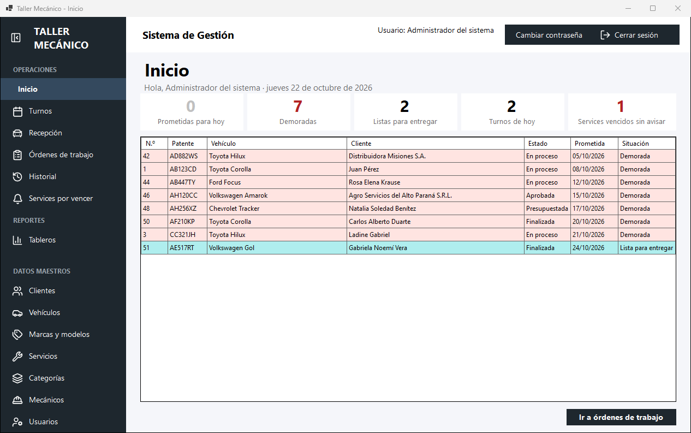

Es la pantalla de trabajo del día para el administrador y el operador. Muestra:

- Cinco tarjetas con contadores: **Prometidas para hoy**, **Demoradas** (la fecha prometida ya pasó y la orden no está cerrada), **Listas para entregar** (trabajo finalizado), **Turnos de hoy** (pendientes) y **Services vencidos sin avisar**.
- Una grilla con las órdenes que piden atención, primero las demoradas, con su situación en la última columna.
- El botón **Ir a órdenes de trabajo**.

Un clic en la tarjeta **Turnos de hoy** abre Turnos; un clic en **Services vencidos sin avisar** abre Services por vencer. Si no hay nada pendiente, la grilla dice "No hay órdenes que requieran atención hoy.".

### Turnos

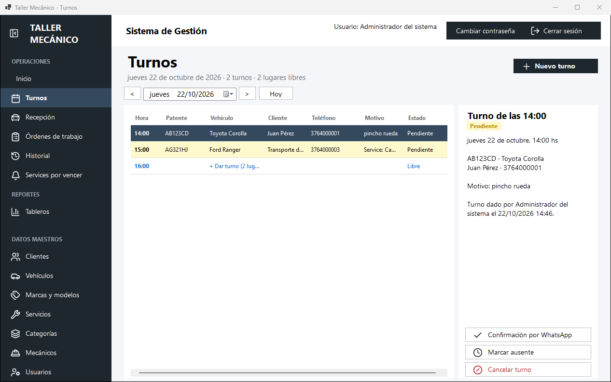

La agenda del taller. Un turno reserva un horario para un vehículo; el mecánico se asigna después, en la recepción o en la gestión de la orden. El taller atiende de 8 a 17 de lunes a viernes y de 8 a 12 los sábados, en franjas de una hora con dos lugares cada una; los domingos no hay agenda.

La grilla muestra el día elegido, una fila por turno y, en cada franja que todavía tiene lugar, una fila "+ Dar turno (n lugares libres)". Los turnos atendidos se ven en verde, los ausentes en rosa y los pendientes cuya franja ya empezó en amarillo.

**Moverse por los días**

1. Use **<** y **>** para cambiar de día, el calendario para elegir una fecha y **Hoy** para volver al día actual.

**Dar un turno**

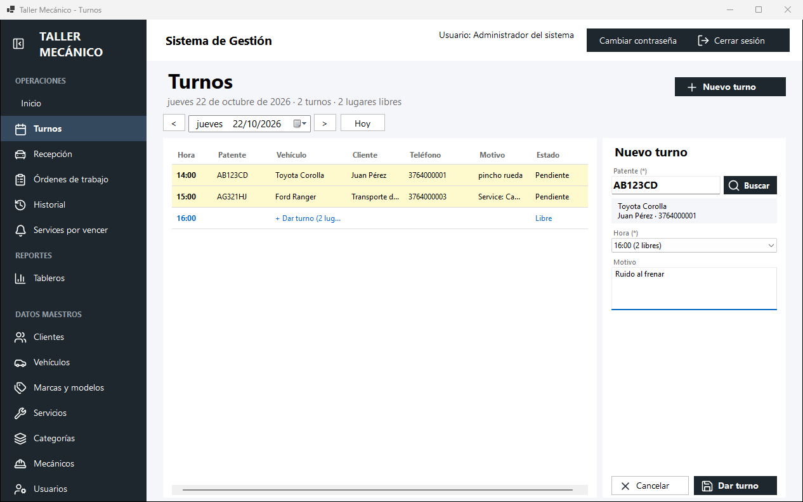

1. Haga clic en una fila "+ Dar turno" de la franja deseada, o en **Nuevo turno** y elija la **Hora** en la lista (solo aparecen las franjas que no terminaron y tienen lugar).
2. Escriba la **Patente** y haga clic en **Buscar** (o presione Enter). Si la patente no está registrada, el sistema ofrece registrar el vehículo y, si hace falta, a su titular, en la ventana de registro rápido (**Registrar y continuar**).
3. Escriba el **Motivo** del turno.
4. Haga clic en **Dar turno**.
5. El sistema ofrece copiar la confirmación para enviarla por WhatsApp. Si acepta, el texto queda en el portapapeles listo para pegar en cualquier aplicación de mensajería.

Un vehículo que ya tiene un turno pendiente no recibe otro. Si otro puesto ocupó el último lugar de la franja mientras se cargaba el turno, el sistema avisa y vuelve a cargar las horas disponibles.

**Ver un turno, cancelarlo o marcar la ausencia**

1. Haga clic en la fila del turno. La tarjeta de la derecha muestra el día y la hora, el vehículo, el cliente y su teléfono, el motivo, quién dio el turno y, si ya fue atendido, el número de la orden.
2. **Confirmación por WhatsApp** copia de nuevo el texto de confirmación de un turno pendiente.
3. **Cancelar turno** cancela un turno pendiente (pide confirmación). No se reprograma: se cancela y se da otro.
4. **Marcar ausente** registra que el cliente no vino; está disponible cuando la franja ya empezó.

Cuando el vehículo se recepciona el mismo día, el turno pasa solo a atendido y queda vinculado a la orden.

### Recepción

El asistente de cuatro pasos con el que el administrador o el operador reciben el vehículo y abren la orden de trabajo. La barra de arriba muestra el paso actual; se avanza con **Siguiente**, se vuelve con **Anterior** (o con un clic en un paso ya completo) y **Cancelar** reinicia el asistente. El panel **Resumen de la recepción**, a la derecha, va mostrando lo cargado. Nada se guarda hasta **Confirmar recepción** en el paso 4.

**Paso 1. Vehículo**

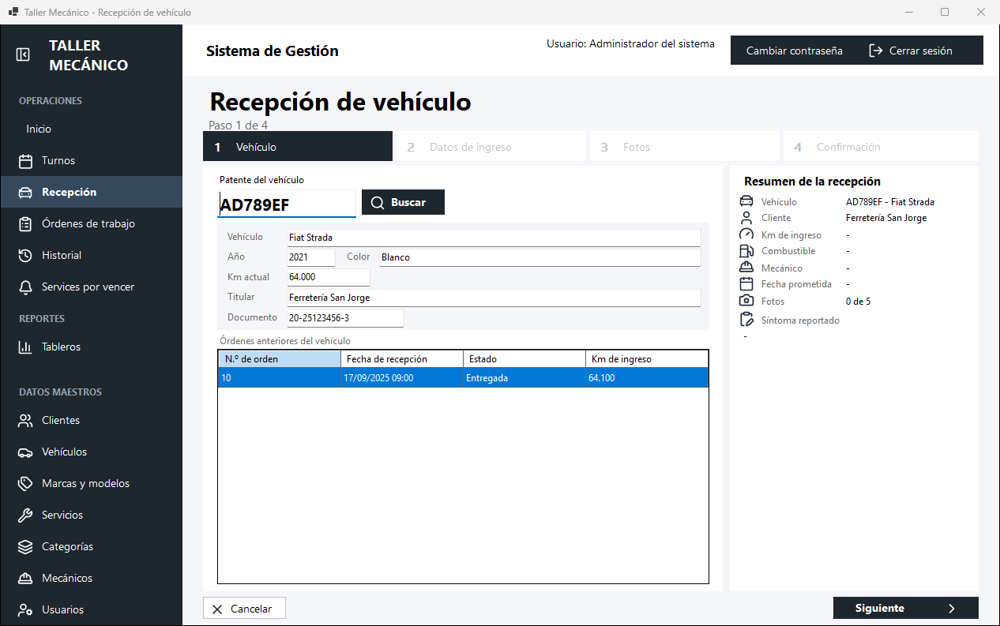

1. Escriba la patente exacta y haga clic en **Buscar**.
2. La pantalla muestra la marca y el modelo, el año, el color, el kilometraje actual, el titular y las órdenes anteriores del vehículo. Si el vehículo tiene un turno pendiente para hoy, al lado de la patente aparece "Tiene turno hoy a las ..." con su motivo, que se copia como síntoma en el paso 2.
3. Si la patente no está registrada, haga clic en **Registrar vehículo**: se abre el registro rápido para cargar el vehículo (patente, marca, modelo, año y color) y su titular, que puede ser un cliente ya registrado o uno nuevo (nombre y documento). Al terminar, la búsqueda se repite sola.
4. Haga clic en **Siguiente**.

No se puede avanzar con un vehículo dado de baja ni con uno que ya tiene una orden abierta (ver [Preguntas frecuentes](#5-preguntas-frecuentes)).

**Paso 2. Datos de ingreso**

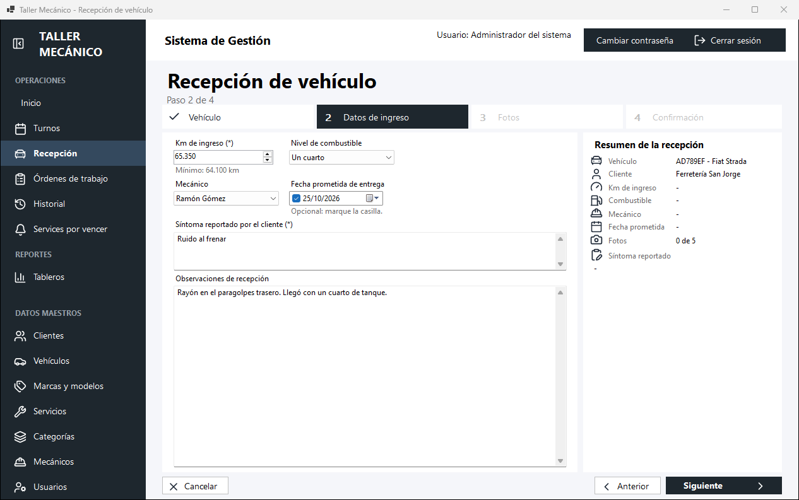

1. Cargue el **Km de ingreso**. No puede ser menor al último kilometraje registrado del vehículo, que se muestra debajo como "Mínimo".
2. Elija el **Nivel de combustible**.
3. Elija el **Mecánico** que va a atender el vehículo (opcional; se puede asignar después desde la gestión de la orden).
4. Marque la casilla de **Fecha prometida de entrega** y elija la fecha (opcional; no puede ser anterior a hoy). Las órdenes cuya fecha prometida pasa sin finalizar aparecen como demoradas en Inicio y en Órdenes de trabajo.
5. Escriba el **Síntoma reportado por el cliente** (obligatorio) y, si hace falta, las **Observaciones de recepción** (estado en que llega el vehículo, daños visibles, objetos dentro, etc.).
6. Haga clic en **Siguiente**.

**Paso 3. Fotos**

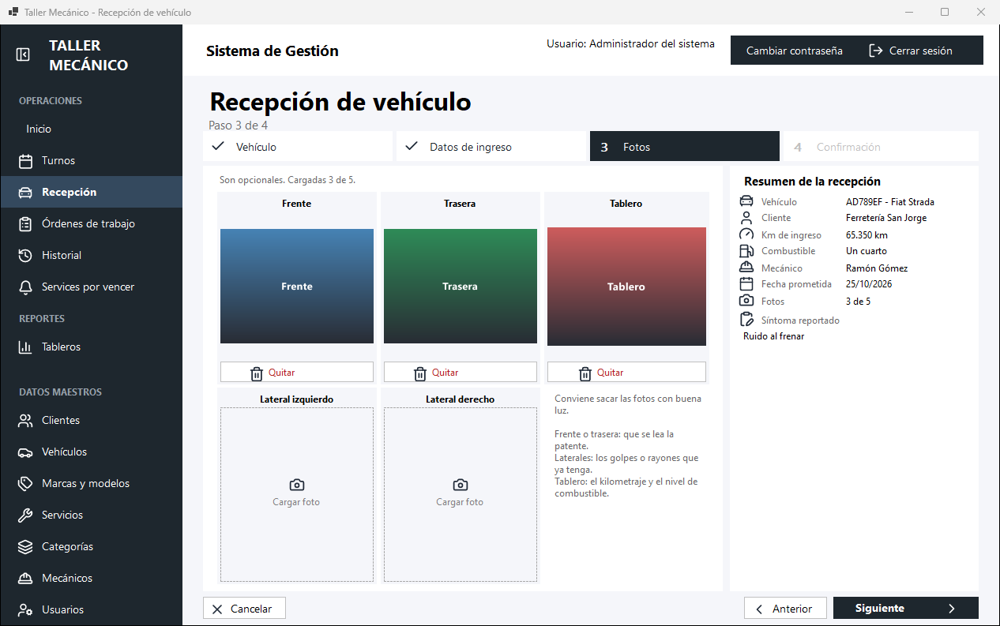

1. Haga clic en cada cuadro (**Frente**, **Trasera**, **Tablero**, **Lateral izquierdo**, **Lateral derecho**) y elija la foto JPG o PNG en el disco. Las fotos se reducen solas para no ocupar de más.
2. Para reemplazar una foto, haga clic de nuevo en el cuadro; para sacarla, use **Quitar**.
3. Haga clic en **Siguiente**.

Las fotos son opcionales, pero son el respaldo del estado en que llegó el vehículo y salen en el acta de recepción.

**Paso 4. Confirmación**

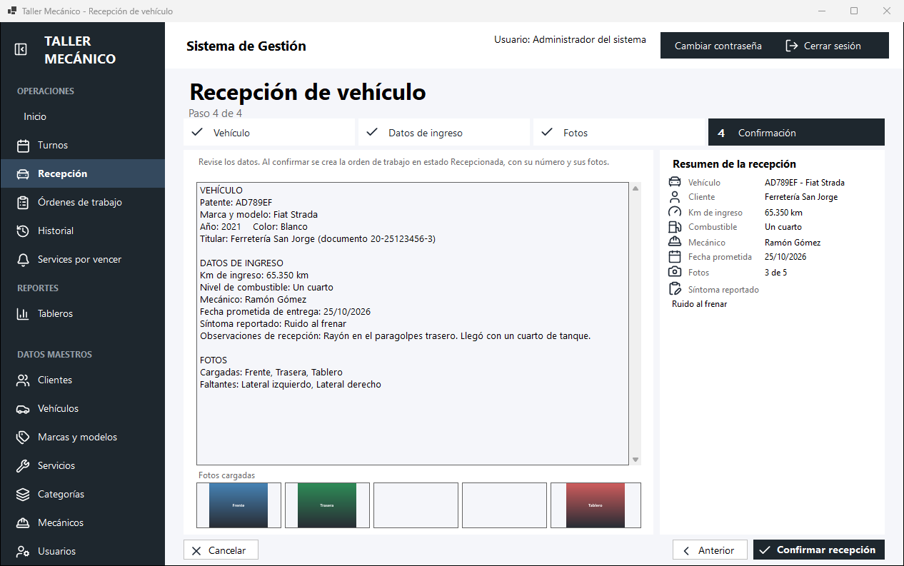

1. Revise el detalle y las fotos cargadas.
2. Haga clic en **Confirmar recepción**. Si faltan fotos, el sistema pregunta si continúa igual.
3. El sistema informa el número de la orden de trabajo creada, en estado Recepcionada, y deja el asistente listo para el próximo vehículo.

### Órdenes de trabajo

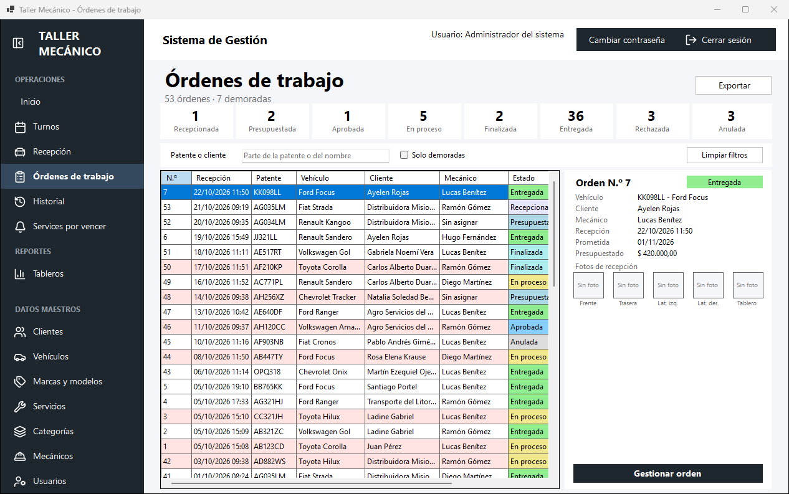

El tablero con todas las órdenes del taller, para el administrador y el operador.

- Arriba, una tarjeta por estado con la cantidad de órdenes: Recepcionada, Presupuestada, Aprobada, En proceso, Finalizada, Entregada, Rechazada y Anulada. Un clic en una tarjeta filtra la grilla por ese estado; otro clic quita el filtro.
- Los filtros por texto (patente o cliente) y **Solo demoradas**; **Limpiar filtros** los reinicia.
- La grilla, con la orden más reciente primero: número, fecha de recepción, patente, vehículo, cliente, mecánico, estado, fecha prometida y situación. Las demoradas se ven con fondo rojo suave.
- A la derecha, el detalle de la orden elegida y sus cinco fotos de recepción.

**Trabajar con una orden**

1. Elija la orden en la grilla.
2. Haga clic en **Gestionar orden** (o doble clic en la fila). Se abre la ventana de [Gestión de la orden](#gestión-de-la-orden).

**Completar las fotos de recepción después de recepcionar**

1. Con la orden elegida y todavía abierta, haga clic en un cuadro vacío de la derecha ("Cargar foto") y elija la foto.
2. Mientras la orden está en Recepcionada, un clic en una foto cargada permite **Reemplazar foto** o **Quitar foto**.

**Exportar** guarda la grilla, con los filtros aplicados, en un archivo CSV que se abre con una planilla de cálculo.

### Gestión de la orden

La ventana que lleva una orden desde la recepción hasta la entrega. Se abre desde Órdenes de trabajo (administrador y operador) o desde Mis órdenes (mecánico). Arriba se ve el número de orden, el vehículo, el cliente, la fecha prometida y el estado; debajo, la barra de etapas marca en verde las cumplidas y resalta la actual. A la derecha están los **Datos de la orden** (mecánico, kilometraje, fechas, síntoma y observaciones) y el **Historial** de cambios de estado, con fecha, usuario y observación. Al pie, **Imprimir** abre el menú de reportes, **Anular orden** está disponible solo para el administrador mientras la orden no está cerrada, y el botón de la derecha es siempre el próximo paso.

**Asignar o cambiar el mecánico**

1. Elija el mecánico en la lista de **Datos de la orden**.
2. Haga clic en **Guardar mecánico**. Se puede hacer en cualquier estado anterior al cierre de la orden.

**Armar el presupuesto (orden Recepcionada)**

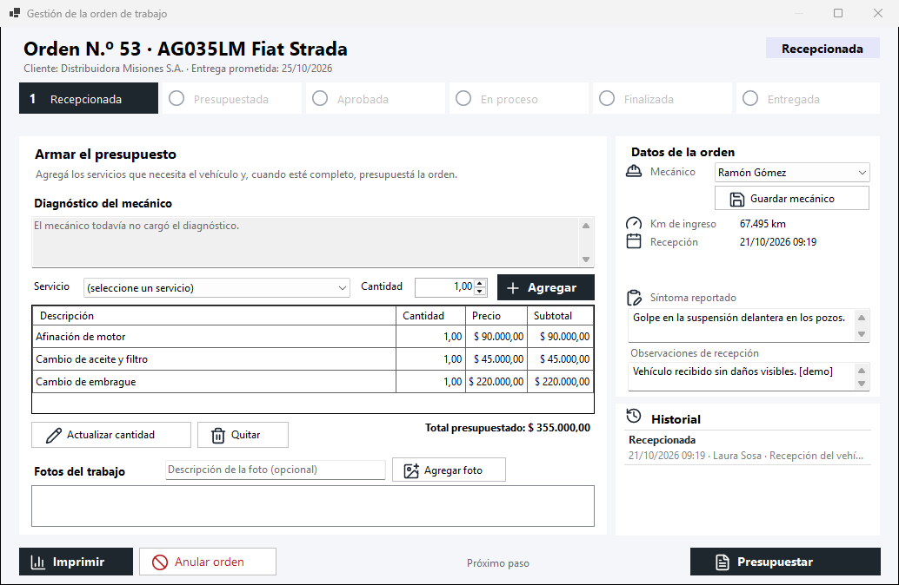

1. Lea el **Diagnóstico del mecánico**, si ya lo cargó (ver [Mis órdenes](#mis-órdenes-mecánico)).
2. Elija un **Servicio** de la lista, indique la **Cantidad** y haga clic en **Agregar**. Repita por cada servicio. El precio es el del catálogo en ese momento y queda guardado en la orden.
3. Para corregir una línea, elíjala en la grilla y use **Actualizar cantidad** o **Quitar**.
4. Cuando el presupuesto esté completo, haga clic en **Presupuestar**. Si la orden no tiene el diagnóstico del mecánico, el sistema pregunta si se presupuesta igual.
5. Para entregarle el presupuesto al cliente, use **Imprimir** → **Presupuesto**. El presupuesto impreso tiene una validez de 15 días.

**Registrar la respuesta del cliente (orden Presupuestada)**

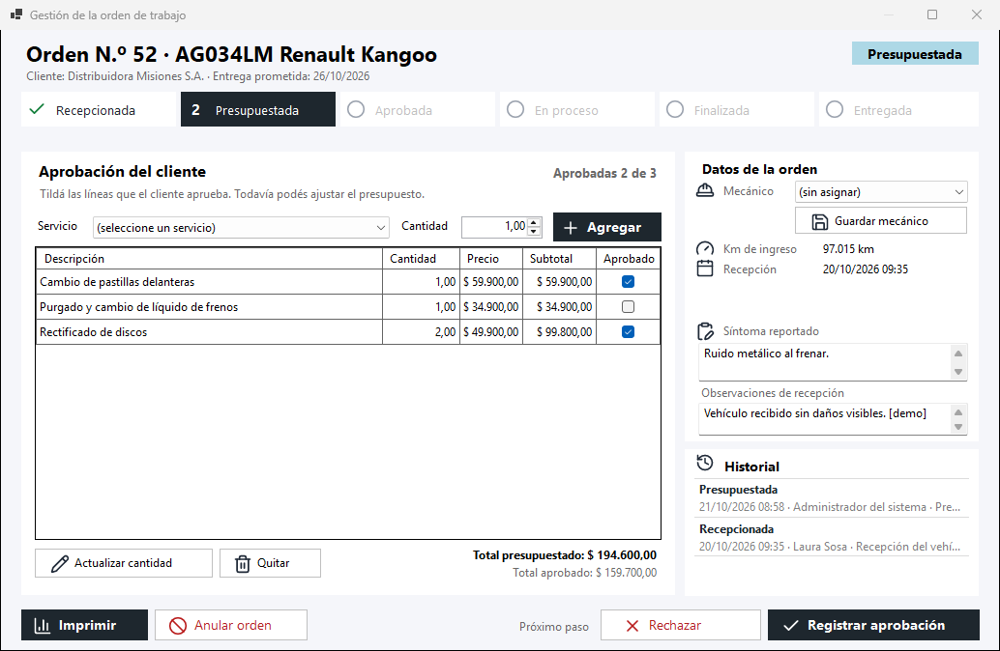

1. Marque en la columna **Aprobado** las líneas que el cliente aprueba. El contador "Aprobadas n de m" y el total aprobado se actualizan con cada marca. Todavía se pueden agregar, cambiar o quitar líneas.
2. Haga clic en **Registrar aprobación** y confirme el total. Hace falta al menos una línea aprobada; la orden pasa a Aprobada.
3. Si el cliente no acepta nada, haga clic en **Rechazar** y confirme. La orden queda Rechazada y cerrada.

**Iniciar el trabajo (orden Aprobada)**

1. Compruebe que la orden tenga mecánico asignado; si falta, el sistema lo pide.
2. Haga clic en **Iniciar trabajo**. La orden pasa a En proceso. Normalmente lo hace el mecánico desde Mis órdenes, pero el administrador y el operador también pueden hacerlo.

**Cargar el avance y finalizar (orden En proceso)**

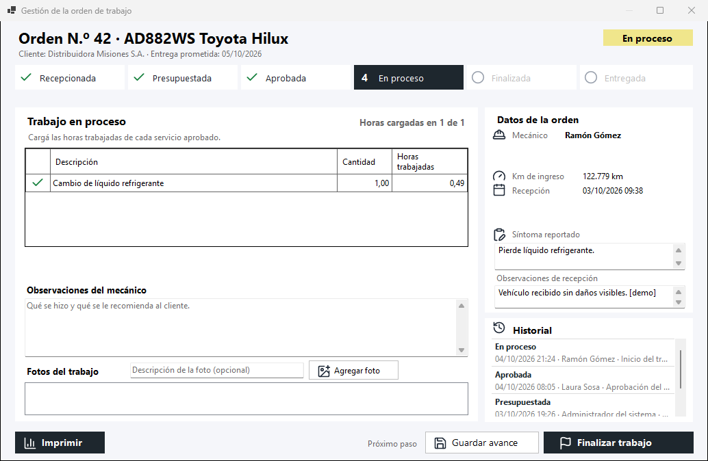

1. Escriba las **Horas trabajadas** en cada línea aprobada y las **Observaciones del mecánico** (qué se hizo y qué se le recomienda al cliente).
2. Agregue **Fotos del trabajo** si hacen falta: escriba una descripción (opcional) y haga clic en **Agregar foto**; **Quitar** saca la foto elegida.
3. **Guardar avance** guarda lo cargado sin cambiar el estado, para seguir después.
4. **Finalizar trabajo** guarda y pasa la orden a Finalizada. Exige horas en todas las líneas aprobadas y las observaciones.

**Avisar al cliente y entregar el vehículo (orden Finalizada)**

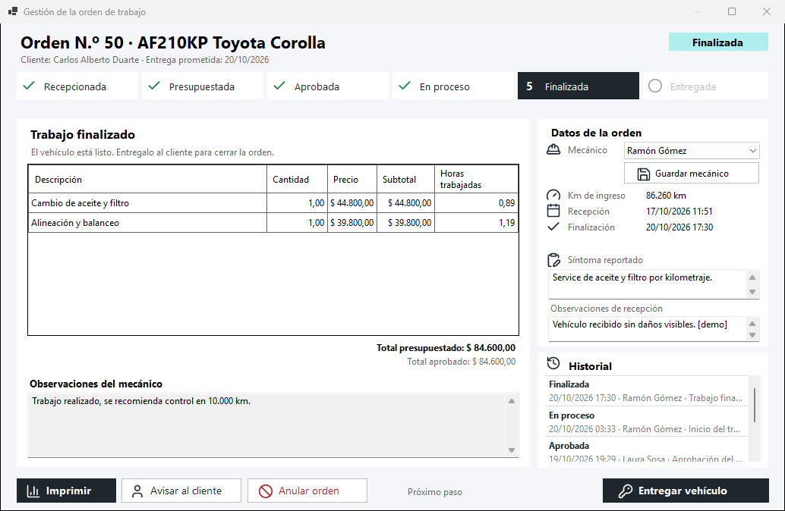

1. Haga clic en **Avisar al cliente**: el sistema copia al portapapeles un mensaje para WhatsApp con el vehículo, el número de orden, los servicios realizados y el total aprobado, y deja en el historial la fila "Cliente avisado". El estado no cambia.
2. Cuando el cliente retira el vehículo, haga clic en **Entregar vehículo** y confirme. La orden pasa a Entregada y queda cerrada; el kilometraje del vehículo se actualiza con el de ingreso.

**Anular una orden**

1. Solo el administrador, y solo mientras la orden no está cerrada: haga clic en **Anular orden**, escriba el motivo (obligatorio) y confirme. La orden pasa a Anulada; nada se borra y el motivo queda en el historial.

Una orden cerrada (Entregada, Rechazada o Anulada) se abre en solo lectura; el botón de la derecha dice **Cerrar**. Si la orden cambió de estado desde otro puesto mientras estaba abierta, el sistema avisa y la vuelve a cargar sin guardar nada.

### Mis órdenes (mecánico)

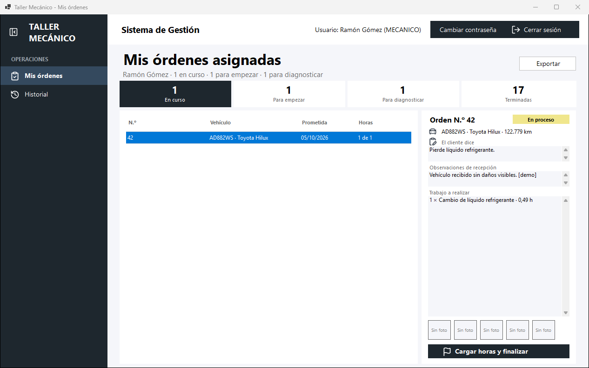

La pantalla de trabajo del mecánico. Lista solo las órdenes que tiene asignadas y no muestra importes.

- Cuatro grupos arriba, con su cantidad: **En curso**, **Para empezar**, **Para diagnosticar** y **Terminadas**. Un clic en un grupo muestra sus órdenes. Las órdenes presupuestadas, a la espera del cliente, no se listan.
- La lista con el número, el vehículo, la fecha prometida y las horas cargadas ("n de m" líneas con horas). Las demoradas se ven con fondo rosado.
- El resumen de la orden elegida: vehículo y kilometraje, lo que dijo el cliente, las observaciones de recepción, el trabajo a realizar, las fotos de recepción y las fotos del trabajo. Un clic en una foto la amplía.

El botón de abajo a la derecha cambia según el estado de la orden (también se abre con doble clic en la fila):

**Cargar el diagnóstico (orden Recepcionada)**

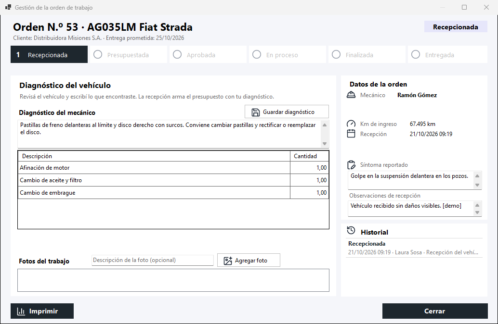

1. En el grupo **Para diagnosticar**, elija la orden y haga clic en **Cargar diagnóstico**.
2. Escriba en **Diagnóstico del mecánico** lo que encontró y haga clic en **Guardar diagnóstico**. El diagnóstico se lee desde la gestión de la orden al armar el presupuesto y sale impreso en el presupuesto y en la orden de trabajo. Se puede corregir mientras la orden siga en Recepcionada.
3. Si hace falta, cargue fotos del trabajo desde esta misma ventana.

**Empezar a trabajar (orden Aprobada)**

1. En el grupo **Para empezar**, elija la orden y haga clic en **Iniciar trabajo**. Se abre la orden; confirme con **Iniciar trabajo**.

**Cargar las horas y terminar (orden En proceso)**

1. En el grupo **En curso**, elija la orden y haga clic en **Cargar horas y finalizar**.
2. Cargue las horas de cada servicio, las observaciones y las fotos del trabajo; **Guardar avance** para seguir después o **Finalizar trabajo** para terminar (ver [Gestión de la orden](#gestión-de-la-orden)).

En el grupo **Terminadas**, **Ver orden** abre la orden en solo lectura. **Exportar** guarda la lista en CSV.

### Historial por patente

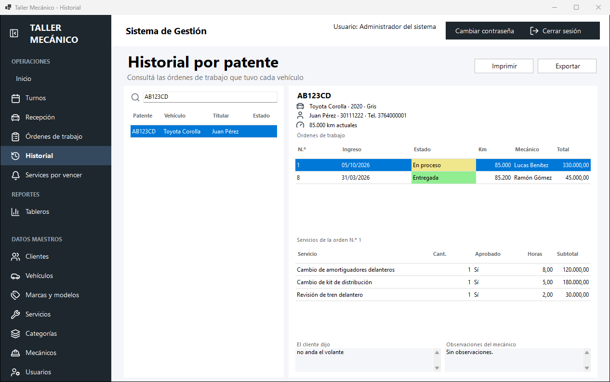

Consulta, para los tres roles, de todas las órdenes que tuvo un vehículo. El mecánico ve el historial sin importes.

1. Escriba la patente, o parte de ella, en el cuadro de búsqueda. La lista se filtra mientras escribe e incluye los vehículos dados de baja, marcados "Baja" al final.
2. Elija el vehículo. A la derecha aparecen sus datos y su titular actual, la lista de órdenes (número, fecha de ingreso, estado, kilometraje, mecánico y total) y, al elegir una orden, sus servicios con cantidad, aprobación y horas, lo que dijo el cliente y las observaciones del mecánico.
3. **Imprimir** abre la vista previa del historial del vehículo; **Exportar** guarda la lista de órdenes en CSV.

### Services por vencer

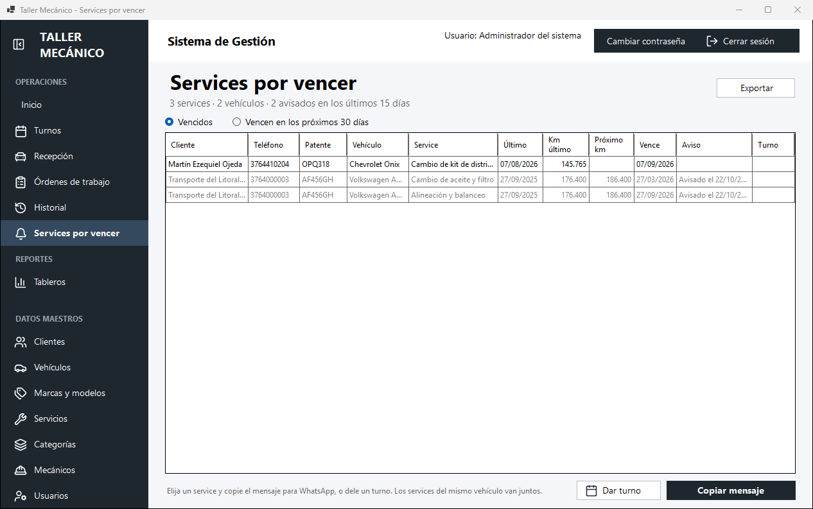

La lista de los services que vencieron o están por vencer, para avisar a los clientes por WhatsApp. Un service vence cuando pasa el tiempo de repetición del servicio (definido en [Servicios](#servicios)) desde la última entrega en la que se hizo. El kilometraje es solo una referencia: el sistema conoce los km del vehículo únicamente cuando entra al taller.

- Con **Vencidos** se listan los que ya vencieron; con **Vencen en los próximos 30 días**, los que vencen pronto.
- Primero van los vehículos sin aviso reciente. Los avisados en los últimos 15 días y los que ya tienen turno se ven en gris al final, con la fecha del aviso o del turno.

**Avisar al cliente**

1. Elija una fila del vehículo y haga clic en **Copiar mensaje** (o doble clic). El mensaje junta todos los services pendientes de ese vehículo. Si alguno ya fue avisado, el sistema pregunta antes.
2. Pegue el mensaje en WhatsApp. El aviso queda registrado con la fecha.

**Dar turno desde esta pantalla**

1. Elija una fila del vehículo y haga clic en **Dar turno**. Se abre Turnos en el primer día con lugar, con la patente y el motivo ("Service: ...") ya cargados; solo falta confirmar con **Dar turno**.

**Exportar** guarda la lista en CSV.

### Tableros

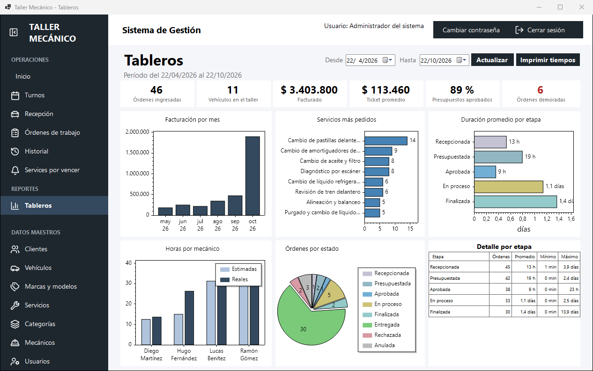

El tablero de gestión del administrador, de solo lectura.

1. Elija el período con **Desde** y **Hasta** (al abrir, es el mes en curso) y haga clic en **Actualizar**.
2. Lea los seis indicadores: **Órdenes ingresadas** en el período, **Vehículos en el taller** hoy, **Facturado** (total aprobado de las órdenes entregadas), **Ticket promedio**, **Presupuestos aprobados** (porcentaje) y **Órdenes demoradas** hoy.
3. Los gráficos muestran la **Facturación por mes** de los últimos seis meses, los **Servicios más pedidos**, las **Horas por mecánico** (estimadas contra reales) y las **Órdenes por estado**.
4. La sección **Duración promedio por etapa** y la grilla **Detalle por etapa** muestran cuánto tarda cada etapa de la orden (de recepcionada a presupuestada, de presupuestada a aprobada, etc.). **Imprimir tiempos** abre esa tabla como reporte.

Si un gráfico no tiene datos en el período, lo indica con "Sin datos para el período".

### Clientes

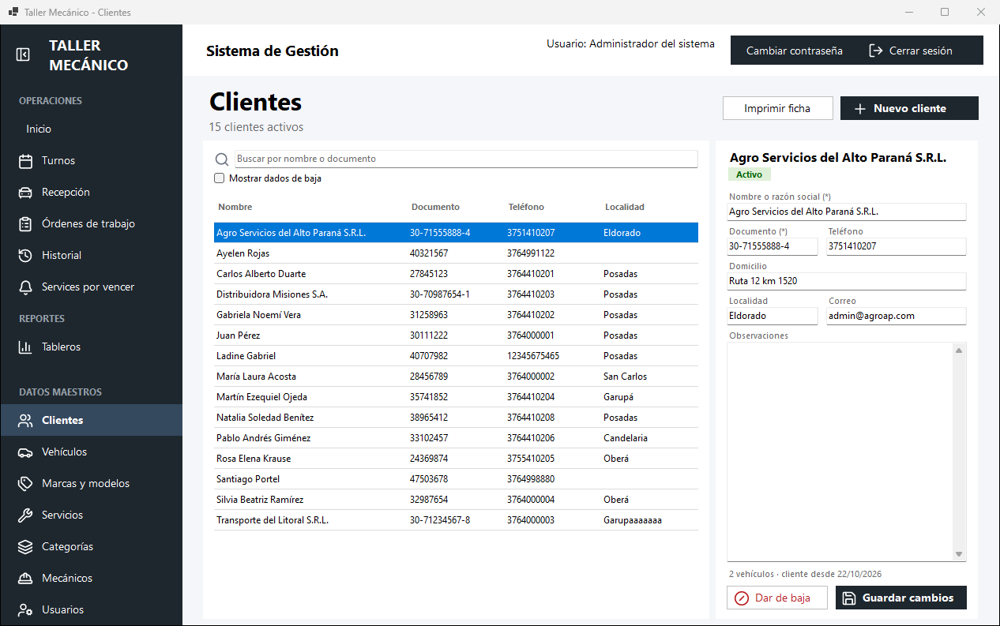

El registro de clientes. Esta pantalla, como Vehículos, Servicios, Categorías, Mecánicos y Usuarios, tiene la lista a la izquierda y la tarjeta del registro elegido a la derecha. La búsqueda filtra mientras escribe; la casilla **Mostrar dados de baja** agrega los inactivos, que se ven en gris al final; un clic en un encabezado ordena por esa columna.

**Agregar un cliente**

1. Haga clic en **Nuevo cliente**.
2. Complete **Nombre o razón social** y **Documento** (obligatorios) y, si los tiene, teléfono, domicilio, localidad, correo y observaciones.
3. Haga clic en **Guardar**. **Cancelar** (o la tecla Escape) descarta el alta.

**Modificar un cliente**

1. Elija el cliente en la lista; la tarjeta muestra sus datos, su estado y cuántos vehículos activos tiene.
2. Cambie lo que haga falta y haga clic en **Guardar cambios**. Si cambia de fila con cambios sin guardar, el sistema pregunta antes de descartarlos.

**Dar de baja y reactivar**

1. Con el cliente elegido, haga clic en **Dar de baja** y confirme. El cliente no se borra: queda inactivo y deja de aparecer en las listas de titulares. Un cliente con vehículos activos no se puede dar de baja.
2. Para reactivarlo, marque **Mostrar dados de baja**, elíjalo y haga clic en **Reactivar**.

**Imprimir ficha** abre la ficha del cliente con sus vehículos, sus órdenes y un resumen de lo facturado.

### Vehículos

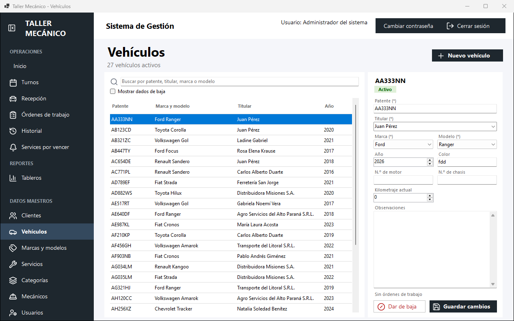

El registro de vehículos. Funciona igual que Clientes. La búsqueda acepta patente, titular, marca o modelo.

1. **Nuevo vehículo**: cargue la **Patente**, elija el **Titular** entre los clientes activos, la **Marca** y el **Modelo** (la lista de modelos depende de la marca), y si los conoce el año, el color, el número de motor y de chasis y el kilometraje. **Guardar**.
2. Para modificar, elija el vehículo, cambie los datos y haga clic en **Guardar cambios**. La tarjeta muestra cuántas órdenes tuvo y la fecha de la última. Un kilometraje menor al registrado se rechaza.
3. **Dar de baja** y **Reactivar** funcionan como en Clientes. No se da de baja un vehículo con una orden sin cerrar, ni se reactiva uno cuyo titular está dado de baja.

Si la patente ya existe, el sistema lo indica al guardar.

### Marcas y modelos

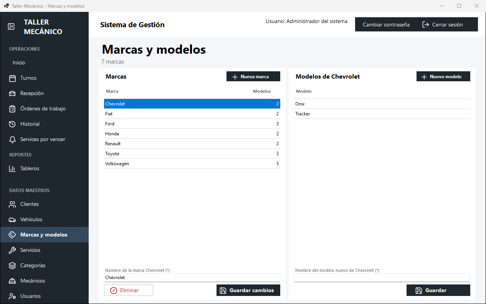

El catálogo de marcas y, para cada marca, sus modelos. A la izquierda la lista de marcas con la cantidad de modelos; a la derecha los modelos de la marca elegida.

1. **Nueva marca**: escriba el nombre al pie de la tarjeta de marcas y haga clic en **Guardar**. Para cambiar el nombre de una marca, elíjala, corrija el nombre y haga clic en **Guardar cambios**.
2. **Nuevo modelo**: con la marca elegida, escriba el nombre al pie de la tarjeta de modelos y haga clic en **Guardar**.
3. **Eliminar** borra la marca o el modelo elegidos. No se puede eliminar una marca con modelos cargados ni un modelo con vehículos cargados.

### Servicios

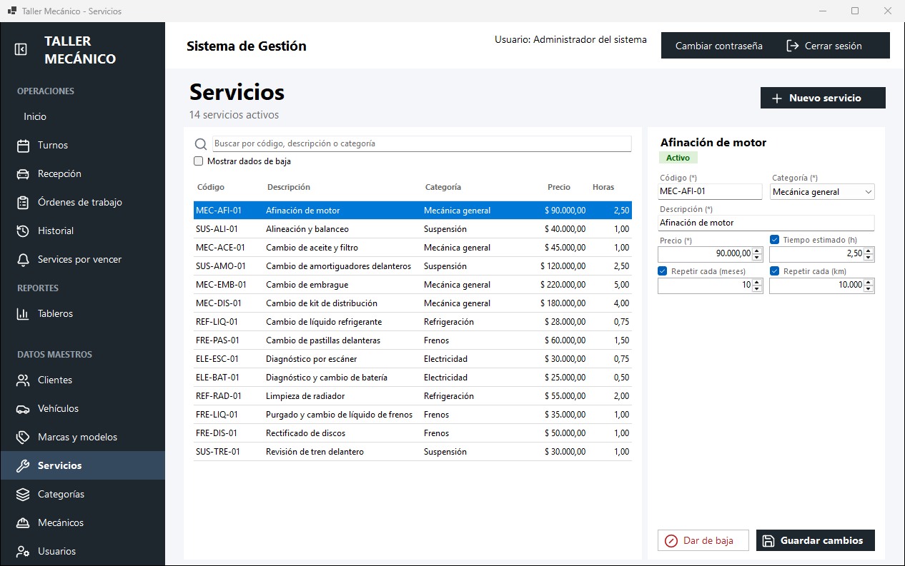

El catálogo de servicios que se presupuestan, solo para el administrador. Cada línea de un presupuesto copia el precio vigente del servicio, así que cambiar el precio no afecta las órdenes ya cargadas.

1. **Nuevo servicio**: cargue el **Código** (único, en mayúsculas), la **Descripción**, la **Categoría** y el **Precio**. Opcionalmente, marque **Tiempo estimado (h)** y cargue las horas, que se usan en el gráfico de horas por mecánico.
2. Para que el service genere avisos de vencimiento, marque **Repetir cada (meses)** y cargue los meses; opcionalmente marque **Repetir cada (km)** y cargue los kilómetros como referencia. Los km solos, sin los meses, no se aceptan.
3. Haga clic en **Guardar** (o **Guardar cambios** al modificar).
4. **Dar de baja** saca el servicio de la lista de los presupuestos nuevos; las órdenes que ya lo tienen no cambian. **Reactivar** lo vuelve a poner, siempre que su categoría esté activa.

### Categorías

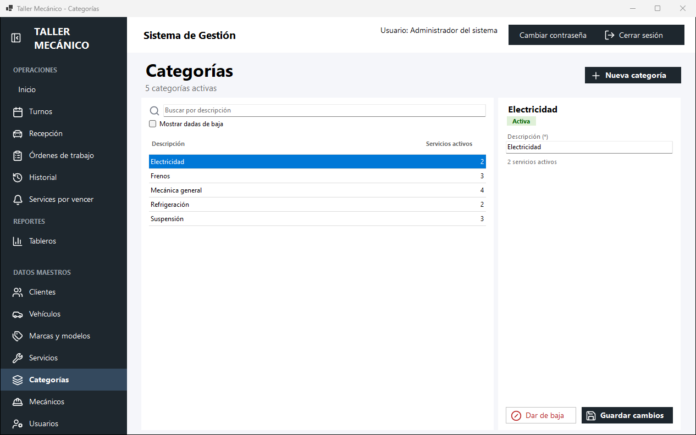

Las categorías en que se agrupan los servicios, solo para el administrador. La lista muestra cuántos servicios activos tiene cada una.

1. **Nueva categoría**: escriba la **Descripción** (única) y haga clic en **Guardar**.
2. Para modificar, elija la categoría, corrija la descripción y haga clic en **Guardar cambios**.
3. **Dar de baja** solo es posible si la categoría no tiene servicios activos; antes hay que pasarlos a otra categoría o darlos de baja.

### Mecánicos

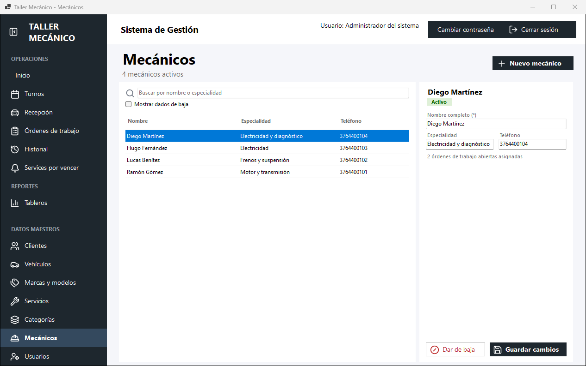

El registro de los mecánicos del taller, solo para el administrador. La tarjeta muestra cuántas órdenes sin cerrar tiene asignadas cada uno.

1. **Nuevo mecánico**: cargue el **Nombre completo** y, si los conoce, la especialidad y el teléfono. **Guardar**.
2. Para modificar, elija el mecánico, cambie los datos y haga clic en **Guardar cambios**. No puede haber dos mecánicos activos con el mismo nombre.
3. **Dar de baja** se rechaza si el mecánico tiene órdenes sin cerrar o un usuario activo del sistema (ver [Preguntas frecuentes](#5-preguntas-frecuentes)).

Para que un mecánico pueda entrar al sistema y ver sus órdenes hay que crearle un usuario con rol MECANICO en [Usuarios](#usuarios). Desde esa misma pantalla también se puede dar de alta al mecánico, con **+ Nuevo mecánico**.

### Usuarios

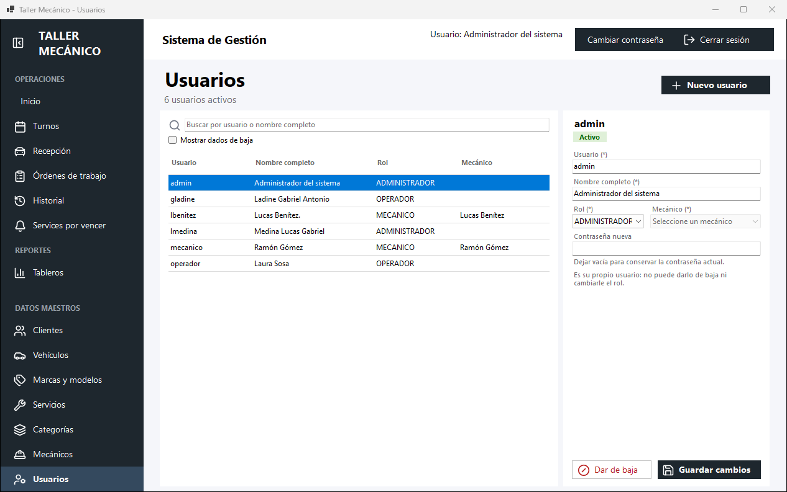

Las cuentas con las que se ingresa al sistema, solo para el administrador. La lista nunca muestra contraseñas.

1. **Nuevo usuario**: cargue el **Usuario** (único), el **Nombre completo**, el **Rol** (ADMINISTRADOR, OPERADOR o MECANICO) y la **Contraseña** (al menos 6 caracteres). Para el rol MECANICO elija además el **Mecánico** al que corresponde la cuenta: la lista muestra solo los mecánicos que todavía no tienen usuario. Si el mecánico no está cargado, use **+ Nuevo mecánico** debajo de la lista: se abre la pantalla Mecánicos, lo da de alta, la cierra y queda elegido. **Guardar**.
2. Para modificar, elija el usuario y cambie los datos; si deja **Contraseña nueva** vacía, la contraseña actual se conserva. **Guardar cambios**. Así se restablece la contraseña de alguien que la olvidó.
3. **Dar de baja** deja al usuario sin acceso sin borrar su historial; **Reactivar** se lo devuelve.

Reglas: el administrador no puede darse de baja ni cambiar su propio rol; no se da de baja al único administrador activo; un usuario con rol MECANICO no se reactiva si su mecánico está dado de baja.

### Cambiar contraseña

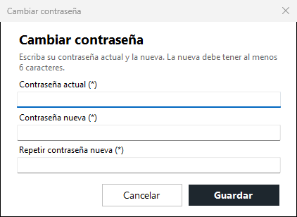

Cualquier usuario cambia su propia contraseña desde **Cambiar contraseña** en la barra superior.

1. Escriba la **Contraseña actual**.
2. Escriba la **Contraseña nueva** (al menos 6 caracteres) y repítala.
3. Haga clic en **Guardar**. El sistema confirma con "Contraseña cambiada.".

### Reportes impresos

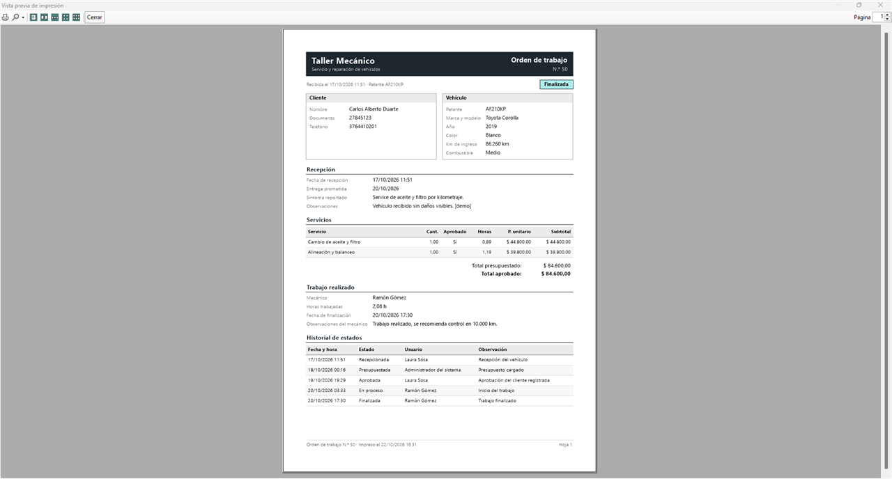

Todos los reportes se abren primero en una vista previa. Desde ella, el botón de la impresora (arriba a la izquierda) imprime; **Cerrar** vuelve a la pantalla. Las hojas se leen bien en blanco y negro.

| Reporte | Dónde se imprime | Qué contiene |
|---|---|---|
| Orden de trabajo | Gestión de la orden: **Imprimir** → **Orden de trabajo** | La orden completa: cliente, vehículo, datos de recepción y diagnóstico, servicios con aprobación y horas, totales, trabajo realizado e historial de estados. El mecánico la imprime sin importes. |
| Presupuesto | Gestión de la orden: **Imprimir** → **Presupuesto** | Las líneas con precio y subtotal, el total, la validez de 15 días y el espacio para la firma del cliente. |
| Acta de recepción | Gestión de la orden: **Imprimir** → **Acta de recepción** | Los datos de ingreso, las cinco fotos de recepción y las firmas del cliente y de quien recibió el vehículo. |
| Colgante de llaves | Gestión de la orden: **Imprimir** → **Colgante de llaves** | Dos etiquetas para colgar en las llaves con la patente, el número de orden, el vehículo, el cliente y las fechas. |
| Fotos del trabajo | Gestión de la orden: **Imprimir** → **Fotos del trabajo** | Las fotos cargadas durante el trabajo, seis por hoja, con su descripción. |
| Historial del vehículo | Historial por patente: **Imprimir** | Los datos del vehículo y todas sus órdenes con sus servicios y observaciones. |
| Ficha del cliente | Clientes: **Imprimir ficha** | Los datos del cliente, sus vehículos con sus órdenes y un resumen de lo facturado. |
| Tiempos por etapa | Tableros: **Imprimir tiempos** | La tabla y el gráfico de duración por etapa del período elegido. |

---

## 4. Flujo completo de una orden de trabajo

Este es el recorrido de un vehículo por el taller, con los usuarios de prueba del README (`admin`, `operador` y `mecanico`, que es el mecánico Ramón Gómez) y el vehículo de patente `AB123CD`. Cada paso indica quién lo hace y en qué pantalla.

1. **Ingresar como `admin`.** Se abre **Inicio** con las tarjetas del día y la grilla de órdenes que piden atención.

2. **Dar el turno** (administrador u operador, en **Turnos**). Clic en un lugar libre de la agenda de hoy o en **Nuevo turno**; patente `AB123CD`, motivo "Ruido al frenar", **Dar turno**. Aceptar copiar la confirmación por WhatsApp y pegarla en la aplicación de mensajería.

3. **Recepcionar el vehículo** (administrador u operador, en **Recepción**). Buscar `AB123CD`: al lado de la patente aparece "Tiene turno hoy a las ..." y el motivo del turno completa el síntoma. Paso 2: kilometraje no menor al mínimo, mecánico **Ramón Gómez** y una fecha prometida. Paso 3: cargar alguna foto (opcional). Paso 4: **Confirmar recepción**. Queda creada la orden en estado Recepcionada y el turno pasa a atendido.

4. **Cargar el diagnóstico** (mecánico, en **Mis órdenes**). Cerrar sesión e ingresar como `mecanico`. En el grupo **Para diagnosticar**, abrir la orden con **Cargar diagnóstico**, escribir lo que encontró y **Guardar diagnóstico**.

5. **Presupuestar y registrar la aprobación** (administrador u operador, en **Órdenes de trabajo**). Ingresar como `operador`. Elegir la orden y **Gestionar orden**: el diagnóstico se lee encima de las líneas. Agregar dos o tres servicios y **Presupuestar**; **Imprimir** → **Presupuesto** para dárselo al cliente. Cuando el cliente responde, marcar en **Aprobado** las líneas que acepta y **Registrar aprobación**. La orden pasa a Aprobada.

6. **Hacer el trabajo** (mecánico, en **Mis órdenes**). Ingresar como `mecanico`. En el grupo **Para empezar**, **Iniciar trabajo**. Luego, en **En curso**, **Cargar horas y finalizar**: horas por línea, observaciones del mecánico, una foto del trabajo y **Finalizar trabajo**. La orden pasa a Finalizada y aparece en Inicio como lista para entregar.

7. **Avisar y entregar** (administrador u operador, en **Órdenes de trabajo**). Ingresar como `admin`. Abrir la orden: **Avisar al cliente** (copia el mensaje para WhatsApp y deja la fila "Cliente avisado" en el historial) y, cuando el cliente retira el vehículo, **Entregar vehículo**. **Imprimir** → **Orden de trabajo**, **Acta de recepción** y **Fotos del trabajo** si se quiere conservar el papel.

8. **Consultar el historial** (cualquier rol, en **Historial**). Buscar `AB123CD`, recorrer sus órdenes e **Imprimir** el historial del vehículo.

9. **Avisar los services vencidos** (administrador u operador, en **Services por vencer**). Con el filtro **Vencidos**, **Copiar mensaje** para un vehículo (queda registrado el aviso) y **Dar turno** desde otra fila: abre Turnos en el primer día con lugar, con la patente y el motivo ya cargados.

10. **Ver los tableros** (administrador, en **Tableros**). Los indicadores y gráficos del mes; cambiar **Desde** a seis meses atrás y **Actualizar**; **Imprimir tiempos** abre la hoja de tiempos por etapa.

11. **Datos maestros** (opcional). En **Clientes**, **Imprimir ficha** de un cliente con varias órdenes; en **Servicios**, **Repetir cada (meses)** es el origen de los avisos de service; en **Usuarios**, dar de baja y reactivar un usuario con **Mostrar dados de baja**.

Los estados por los que pasa la orden, en orden: Recepcionada → Presupuestada → Aprobada → En proceso → Finalizada → Entregada. Desde Presupuestada el cliente puede rechazar (Rechazada) y el administrador puede anular la orden en cualquier estado anterior a la entrega (Anulada). Los tres son estados finales: la orden queda cerrada y el vehículo puede volver a recepcionarse.

---

## 5. Preguntas frecuentes

**Al buscar la patente en Recepción aparece "El vehículo ... ya tiene una orden de trabajo abierta".**

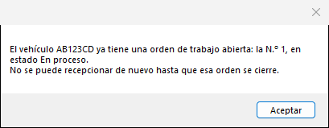

Un vehículo tiene a lo sumo una orden abierta. Mientras esa orden no esté entregada, rechazada o anulada, no se puede recepcionar de nuevo: el mensaje indica el número y el estado de la orden. Búsquela en Órdenes de trabajo y termínela (o, si corresponde, pida al administrador que la anule) antes de hacer la nueva recepción.

**En el paso 2 de Recepción aparece "El kilometraje de ingreso no puede ser menor a ... km".**

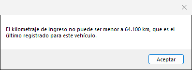

El kilometraje de ingreso no puede ser menor al último registrado para ese vehículo, que se muestra debajo del campo como "Mínimo". Revise el tablero del vehículo y cargue el valor real. Si el kilometraje registrado está mal (por ejemplo, se cargó de más en una orden anterior o al dar de alta el vehículo), el administrador u operador lo corrige en Vehículos antes de recepcionar.

**En Mecánicos, al dar de baja aparece "No se puede dar de baja: el mecánico tiene ... usuario(s) activo(s) del sistema".**

Un mecánico con un usuario activo seguiría ingresando al sistema como mecánico. Primero dé de baja su usuario en Usuarios y después al mecánico. La baja también se rechaza si el mecánico tiene órdenes sin cerrar: reasígnelas desde la gestión de cada orden con **Guardar mecánico**.

**El botón INGRESAR del login quedó deshabilitado y dice "Demasiados intentos. Espere 30 s".**

Después de cinco intentos fallidos seguidos, el ingreso se bloquea 30 segundos. Espere a que termine la cuenta regresiva y vuelva a intentar. Si no recuerda la contraseña, el administrador puede asignarle una nueva desde Usuarios. El bloqueo se reinicia al cerrar y volver a abrir el sistema.

**No puedo dar de baja un cliente, un vehículo o una categoría.**

El sistema no deja de baja un registro del que dependen otros activos: un cliente con vehículos activos ("Cámbieles el titular o delos de baja primero"), un vehículo con una orden sin cerrar ("Ciérrela o anúlela primero") o una categoría con servicios activos ("Páselos a otra categoría o delos de baja primero"). Resuelva primero lo que indica el mensaje.

**Al guardar un cliente, un vehículo, un servicio o un usuario aparece "Ya existe ...".**

El documento del cliente, la patente, el código del servicio y el nombre de usuario son únicos. El registro que busca puede estar dado de baja: marque **Mostrar dados de baja** y, si es el mismo, use **Reactivar** en lugar de crear uno nuevo.

**Una orden "cambió de estado" mientras la tenía abierta.**

Otro puesto avanzó la misma orden. El sistema no guarda lo que estaba haciendo, vuelve a cargar la orden y muestra su estado actual; revise y repita la acción si todavía corresponde.

**Dónde quedan los errores.**

Si aparece un error inesperado, el sistema pregunta si se sigue trabajando o se sale. El detalle queda en el archivo `errores.log` dentro de la carpeta `TallerMecanico` de los datos locales del usuario de Windows (`%LocalAppData%\TallerMecanico`), con la fecha, el usuario y la pantalla.
